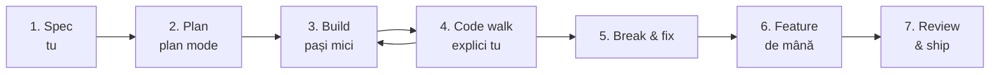

# Metoda

Cum înveți aici și de ce așa.

## De ce altfel decât până acum

În 4 săptămâni ai făcut zilele 1–7 de JavaScript, și codul tău e bun. Dar ritmul ăla nu te duce la un job în 2–3 luni, și nu din vina ta: metoda îți cerea seturi de exerciții pentru fiecare concept, pe domenii la întâmplare. Exersai cel mai ieftin skill din 2026, adică să-ți amintești sintaxa.

În 2026, un developer scrie mult mai puțin cod de mână. Codul îl scrie în mare parte AI-ul. Ce face developerul și ce verifică un interviu:

- **decide** ce se construiește și cum (structură, compromisuri, ce bibliotecă);
- **citește și înțelege** cod scris de altcineva, om sau AI;
- **verifică**: rulează, testează, face review, se uită la securitate;
- **depanează** când ceva nu merge;
- **explică** colegilor, la review și la interviu.

Ghidul antrenează exact lucrurile astea. Sintaxa o prinzi din mers, pentru că o citești zilnic în cod real.

## Cele două activități

### 1. Fișele de concept

Fiecare concept important are o fișă: ce e, de ce contează, un exemplu minim, cum arată în cod real, capcana și întrebarea de interviu. Formatul e în [03-cum-arata-o-fisa.md](03-cum-arata-o-fisa.md).

Le citești și rulezi exemplele, fără exerciții. Exercițiul adevărat e proiectul.

### 2. Proiectele

Patru proiecte, în patru domenii diferite, fiecare într-un repo separat pe GitHub-ul tău (vezi [proiecte](../proiecte/)):

| | Proiect | Ce fel de aplicație |
|---|---|---|
| P1 | Shelf | Frontend cu API public |
| P2 | Invoicer | Full-stack de business: React + NestJS + Postgres |
| P3 | Booking | Aplicație cu conturi, roluri, teste, CI și flux de echipă |
| P4 | Kitchen AI | Produs AI din domeniul tău |

## Bucla unui proiect: 7 pași

Fiecare proiect, și de fapt fiecare feature mai mare, trece prin aceeași buclă.

**1. Spec: scrii tu, de mână (30–60 min).** Ce face aplicația, pentru cine, ce ecrane are, ce date. Îl pui în README-ul proiectului. Dacă nu știi ce vrei, Claude decide în locul tău, și atunci nu e proiectul tău.

**2. Plan: Claude Code în plan mode.** Îi dai spec-ul și îi ceri un plan: structura de foldere, componentele, modelul de date, ordinea PR-urilor. Citești planul și la fiecare decizie întrebi „de ce așa și nu altfel?”. Aprobi doar ce înțelegi.

**3. Build: pe pași mici.** Un feature înseamnă un branch și un PR. După fiecare pas rulezi aplicația, te uiți la diff și faci commit. Nu ceri niciodată „fă-mi toată aplicația”.

**4. Code walk: explici tu.** La finalul fiecărui feature, nu doar la final de proiect, treci prin fișierele modificate și le explici cu cuvintele tale. Claude te ascultă, te corectează și îți pune întrebări. Ce ai înțeles intră în `ARCHITECTURE.md`. Pasul ăsta transformă „am construit cu AI” în „știu să construiesc”.

**5. Break & fix.** Cel puțin o dată pe proiect, îi ceri lui Claude să strice ceva subtil fără să-ți spună ce. Tu găsești problema cu loguri, debugger și DevTools. Debugging-ul e skill-ul pe care AI-ul nu ți-l poate lua.

**6. Un feature de mână.** Unul mic pe proiect, scris de tine. Claude face doar review după. Îți ține mâna caldă pentru live coding la interviu. Fiecare brief de proiect îți propune unul.

**7. Review & ship.** PR, review de la Bogdan, merge, deploy, README în engleză cu screenshot și link live.

**Proporția sănătoasă:** cam jumătate din timp construiești, un sfert faci code walk, un sfert restul. Dacă code walk-ul îți ia mult mai puțin de un sfert, construiești prea repede.

Detaliile practice despre lucrul cu Claude Code sunt în [12-lucrul-cu-ai](../12-lucrul-cu-ai/).

## Regulile

1. **Nu faci commit la cod pe care nu-l poți explica.** Dacă Claude a scris ceva ce nu înțelegi, te oprești și întrebi până înțelegi, sau îi ceri o variantă mai simplă.
2. **Ziua se închide doar dacă poți explica ce ai făcut azi ca la interviu.** E regula din planul vechi și cea mai bună idee din el.
3. **Claude e un coleg, nu un oracol.** Când ceva sună ciudat, verifici în documentația oficială. AI-ul e antrenat pe cod vechi și uneori inventează.
4. **Blocat peste 30 de minute? Întrebi.** Întâi pe Claude, cu întrebarea bine pusă: ce ai vrut, ce s-a întâmplat (eroarea exactă), ce ai încercat. Apoi pe Bogdan.
5. **Commit și push în fiecare zi.** GitHub-ul tău e și jurnalul tău public.

## Ce scrii totuși de mână

- **Kata-uri** de 20 de minute, de 3 ori pe săptămână, fără AI. Lista e în [13-interviuri/05-live-coding.md](../13-interviuri/05-live-coding.md).
- **Feature-ul de mână** din fiecare proiect.
- **Spec-ul, `ARCHITECTURE.md` și jurnalul.**

Ajunge cât să nu te blochezi la un live coding. Nu ai nevoie de mai mult.

## Checkpoint-urile

Cinci opriri în care verifici că ai înțeles cu adevărat înainte să mergi mai departe. Fiecare are o listă de lucruri pe care trebuie să le explici fără notițe, un quiz dat de Claude, livrabile și un call cu Bogdan. Le bifezi prin PR, deci exersezi fluxul de echipă din prima săptămână. Detalii în [checkpoints](../checkpoints/).

## Ce NU faci

- Nu citești documentația de la cap la coadă înainte să construiești ceva.
- Nu te uiți la tutoriale video de 10 ore.
- Nu sari peste code walk ca să termini mai repede.
- Nu lași Claude să facă un proiect întreg dintr-un singur prompt.
- Nu-ți compari progresul cu postările de pe LinkedIn.

## Mai departe

- [02 · Ritmul zilnic](02-ritmul-zilnic.md)
- [senior-tips.md](../senior-tips.md)
