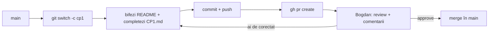

# Publică ghidul pe GitHub-ul tău

Ghidul ăsta ți l-a dat Bogdan ca arhivă. Îl pui în WSL, îl publici ca repo pe GitHub-ul tău cu ajutorul Claude Code, îl adaugi pe Bogdan colaborator și înveți fluxul prin care bifezi fiecare checkpoint: un pull request la care el îți face review.

E prima ta sarcină reală cu Claude Code, așa că o faci în **manual mode** și citești fiecare comandă înainte s-o aprobi.

## Pasul 1 — Pune folderul în WSL

Arhiva e probabil în `Downloads` pe Windows. Numele exact poate diferi, deci verifică-l întâi cu `ls /mnt/c/Users/<user-windows>/Downloads`.

```bash
sudo apt install -y unzip  # Ubuntu doesn't always ship with it
cd ~/code
cp /mnt/c/Users/<user-windows>/Downloads/full-stack-de-la-zero.zip .
unzip full-stack-de-la-zero.zip
rm -rf __MACOSX            # only if it exists: junk added by macOS archives
cd full-stack-de-la-zero
ls -la
```

**Verifică.** Vezi `README.md`, `CLAUDE.md`, `.gitignore` și folderele `00-start` … `13-interviuri`. **Nu** trebuie să existe un folder `.git`: repo-ul îl creezi tu acum. Dacă există, întreabă-l pe Bogdan înainte să-l ștergi.

## Pasul 2 — Publică repo-ul cu Claude Code

```bash
claude
```

Verifică în bara de jos că ești în `⏸ manual mode on` (`Shift+Tab` până acolo), apoi trimite:

```text
Vreau să public folderul ăsta ca repo public pe GitHub-ul meu, cu numele
full-stack-de-la-zero. Folosește git și gh (sunt deja logat cu gh).
Înainte de fiecare comandă, explică-mi în una-două propoziții ce face și de ce.
Fă primul commit cu un mesaj în stil conventional commits.
```

Ar trebui să-ți propună, pe rând, ceva foarte apropiat de:

```bash
git init                     # creates the local repository (the .git folder)
git add .                    # stages all files for the first commit (.gitignore filters)
git status                   # shows what will be committed. Read the list!
git commit -m "chore: import learning guide"
gh repo create full-stack-de-la-zero --public --source=. --push
```

Ultima comandă face trei lucruri: creează repo-ul pe GitHub, îl leagă de folderul tău ca remote-ul `origin` și face push la commit-uri.

Dacă îți propune altceva (alt nume, `--private`, remote HTTPS, `git push --force`), oprește-l cu `Esc` și întreabă-l de ce. Uneori are un motiv bun. Important e să-l înțelegi tu înainte să aprobi.

**Verifică.**

```bash
git log --oneline
git remote -v                # origin -> git@github.com:FildiroiVladut/full-stack-de-la-zero.git
gh repo view --web           # opens the repo in the browser
```

**Ce s-a întâmplat de fapt.** Ai acum două copii ale aceluiași istoric: una locală (folderul `.git`) și una pe GitHub (`origin`). `git push` trimite commit-urile tale acolo, iar `git pull` le aduce înapoi pe cele noi. Pull request-urile și review-urile sunt concepte GitHub, nu Git: ele se întâmplă pe site, peste branch-urile pe care le-ai urcat.

## Pasul 3 — Adaugă-l pe Bogdan colaborator

Pe GitHub, în repo:

1. **Settings** (dacă nu-l vezi, e în meniul **More**).
2. În secțiunea **Access** din stânga → **Collaborators**.
3. **Add people** → caută `itsbogdann` → **Add … to full-stack-de-la-zero**.

Sau din terminal (`{owner}` și `{repo}` le completează `gh` singur, din folderul curent):

```bash
gh api --method PUT "repos/{owner}/{repo}/collaborators/itsbogdann"
```

Bogdan primește o invitație pe care trebuie s-o accepte. Abia după aceea poate fi cerut ca reviewer.

## Pasul 4 — Fluxul de checkpoint prin pull request

Fiecare checkpoint (CP1 … CP5) îl închizi la fel. Așa exersezi fluxul de PR din prima săptămână, nu abia la P3.



```bash
git switch main && git pull                 # start from an up-to-date main
git switch -c cp1                           # new branch for this checkpoint

# edit: check the boxes in README.md, fill in checkpoints/CP1.md

git add README.md checkpoints/CP1.md
git commit -m "docs: complete CP1"
git push -u origin cp1                      # -u links the local branch to the remote one
gh pr create --fill --reviewer itsbogdann
```

Apoi:

1. Bogdan lasă comentarii pe PR. Le citești pe GitHub sau cu `gh pr view --comments`.
2. Răspunzi la fiecare comentariu. Ce ai de corectat corectezi pe **același branch**: `git add`, `git commit`, `git push`. PR-ul se actualizează singur.
3. După **Approve**:

   ```bash
   gh pr merge --squash --delete-branch
   git switch main && git pull
   ```

Ce trebuie să conțină fiecare checkpoint și cum decurge call-ul de review e în [checkpoints/README.md](../checkpoints/README.md). Fluxul de PR complet, cu descrieri bune, conflicte și reguli de echipă, e în [09-git-github-echipa/03-pull-requests.md](../09-git-github-echipa/03-pull-requests.md).

**Capcana.** Să lucrezi direct pe `main` și să faci push acolo. Merge tehnic, dar sari peste review, adică exact lucrul pe care îl exersezi. În echipe reale, `main` e protejat și nici nu te lasă.

<details>
<summary>Întrebare de interviu: Ce e un pull request și de ce nu facem push direct pe main?</summary>

Un pull request e o cerere de a integra un branch în altul, de obicei în `main`. În jurul lui se face colaborarea: diff-ul e vizibil, colegii lasă comentarii pe linii, CI-ul rulează testele, iar merge-ul se face doar după aprobare și cu verificările trecute. Nu facem push direct pe `main` ca să păstrăm o ramură mereu funcțională și ca fiecare schimbare să fie văzută de încă un om. PR-ul rămâne și ca documentație: peste un an vezi de ce s-a făcut o schimbare.
</details>

## Mai departe

- [gh repo create — GitHub CLI manual](https://cli.github.com/manual/gh_repo_create)
- [Inviting collaborators to a personal repository — GitHub Docs](https://docs.github.com/en/account-and-profile/setting-up-and-managing-your-personal-account-on-github/managing-access-to-your-personal-repositories/inviting-collaborators-to-a-personal-repository)
- [About pull requests — GitHub Docs](https://docs.github.com/en/pull-requests/collaborating-with-pull-requests/proposing-changes-to-your-work-with-pull-requests/about-pull-requests)
