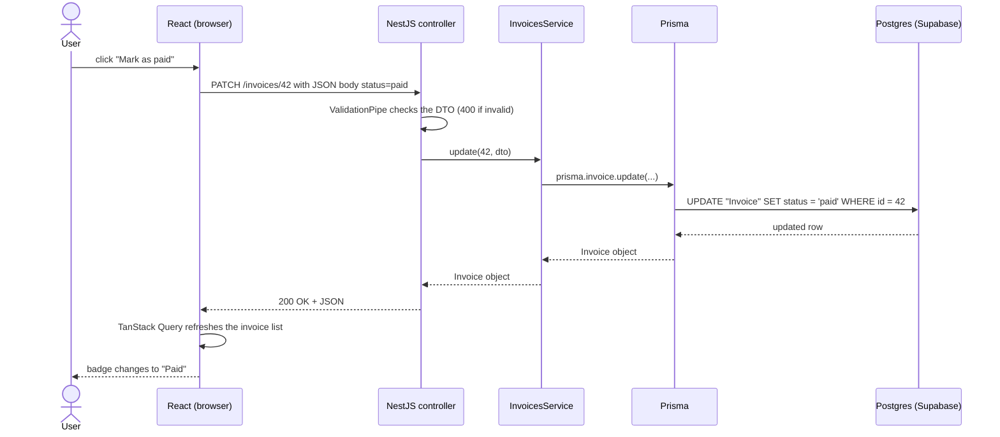

# Frontend vs backend

Fișierul ăsta e inima capitolului. La CP1 trebuie să poți explica, fără notițe, drumul unui click de la buton până în baza de date și înapoi.

## Cine ce face

**Ce e.** Frontend-ul e partea care rulează în browser: ce vede și ce atinge utilizatorul. Backend-ul rulează pe server: regulile, datele și secretele. Baza de date păstrează datele și le apără integritatea.

| Frontend (React, în browser) | Backend (NestJS, pe server) | Baza de date (Postgres) |
|---|---|---|
| afișează datele | aplică regulile de business | păstrează datele |
| reacționează la click-uri și formulare | validează **autoritar** fiecare input | garantează constrângeri (`UNIQUE`, `NOT NULL`, chei străine) |
| validare pentru UX („emailul pare greșit”) | verifică cine ești și ce ai voie | tranzacții |
| navigare între ecrane | ține secretele (chei API, parola bazei de date) | |
| state local (formular deschis, filtru selectat) | vorbește cu servicii externe (email, plăți, Claude) | |
| apelează API-ul | rulează joburi programate (factura a devenit `overdue`) | |

O analogie de restaurant: sala vede meniul și farfuria. Bucătăria are rețetele, furnizorii și cuțitele. Clientul nu intră în bucătărie, oricât de frumos ar cere.

**De ce contează.** La fiecare feature nou trebuie să decizi unde pune fiecare bucată de logică. Decizia greșită e fie o gaură de securitate, fie o interfață lentă.

**Capcana.** Validarea făcută doar în frontend. E pentru confortul utilizatorului, nu pentru siguranță: oricine poate trimite request-ul direct, ocolind formularul.

<details>
<summary>Întrebare de interviu: De ce nu se conectează frontend-ul direct la baza de date?</summary>

Pentru că tot ce e în browser e public: credențialele bazei de date ar fi la vedere, iar oricine ar putea citi sau șterge orice. Backend-ul stă la mijloc, ține credențialele, verifică cine face request-ul și ce are voie, validează datele și aplică regulile de business. Există o nuanță: platforme ca Supabase permit acces din frontend cu o cheie publică, dar doar pentru că baza de date aplică reguli per utilizator (Row Level Security). Acolo regulile de securitate se mută în baza de date, nu dispar.
</details>

## De ce există backend

**Ce e.** Patru motive pe care le recunoști în fiecare proiect:

1. **Secrete.** Cheia Claude API din P4 și parola bazei de date nu au voie în browser.
2. **Acces la date.** Doar serverul are connection string-ul spre Postgres.
3. **Reguli și validare.** Totalul facturii se calculează pe server, iar o rezervare în trecut se refuză pe server.
4. **Autorizare.** Un utilizator își vede doar rezervările lui, iar un `member` nu poate șterge săli.

La astea se adaugă munca ce trebuie să se întâmple și dacă utilizatorul a închis tab-ul: emailuri, joburi programate, procesarea unui fișier încărcat.

**Exemplu minim.** De ce nu ai încredere în ce vine din browser:

```ts
// BAD — trusts the total sent by the browser
async create(dto: { clientId: number; lines: LineDto[]; totalCents: number }) {
  return this.prisma.invoice.create({ data: { clientId: dto.clientId, totalCents: dto.totalCents } });
}

// GOOD — the server computes the total from the lines
async create(dto: { clientId: number; lines: LineDto[] }) {
  const totalCents = dto.lines.reduce((sum, l) => sum + l.quantity * l.unitPriceCents, 0);
  // ...save the invoice with the lines and the computed totalCents
}
```

În DevTools poți edita orice request și îl poți retrimite, iar cu `curl` la fel. Prima variantă îi permite oricui să-și facă o factură de 1 leu.

**Capcana.** Când Claude generează un DTO, verifică ce câmpuri acceptă. Dacă acceptă `totalCents`, `status: "paid"` sau `role: "admin"` de la client, ai găsit un bug de securitate.

<details>
<summary>Întrebare de interviu: Ce logică ai pune în frontend și ce logică în backend?</summary>

În frontend: tot ce ține de afișare și interacțiune, plus validare pentru feedback rapid. În backend: tot ce trebuie să fie corect și de încredere, adică validarea finală, calculele care se salvează, verificările de permisiuni, accesul la date și la servicii externe cu chei secrete. Regula mea: dacă un utilizator rău-intenționat ar câștiga ceva modificând logica, ea stă pe server.
</details>

## Drumul complet al unui request

**Ce e.** Ce se întâmplă când utilizatorul apasă „Mark as paid” pe o factură în P2 Invoicer:



**Cum îl vezi în cod real.** Fiecare săgeată din diagramă are corespondent în codul tău:

```tsx
// 1. Frontend — the button and the mutation (React + TanStack Query)
const queryClient = useQueryClient();
const markPaid = useMutation({
  mutationFn: (id: number) => api(`/invoices/${id}`, { method: "PATCH", body: JSON.stringify({ status: "paid" }) }),
  onSuccess: () => queryClient.invalidateQueries({ queryKey: ["invoices"] }),
});

<button onClick={() => markPaid.mutate(invoice.id)} disabled={markPaid.isPending}>Mark as paid</button>;
```

```ts
// 2. Frontend — a tiny API helper
async function api(path: string, init?: RequestInit) {
  const res = await fetch(`${import.meta.env.VITE_API_URL}${path}`, {
    ...init,
    headers: { "Content-Type": "application/json", ...init?.headers },
  });
  if (!res.ok) throw new Error(`API error ${res.status}`);
  return res.json();
}
```

```ts
// 3. Backend — controller: HTTP in, HTTP out
@Patch(":id")
update(@Param("id", ParseIntPipe) id: number, @Body() dto: UpdateInvoiceDto) {
  return this.invoices.update(id, dto);
}

// 4. Backend — service: business rules + data access
async update(id: number, dto: UpdateInvoiceDto) {
  await this.findOne(id); // throws NotFoundException → 404
  return this.prisma.invoice.update({ where: { id }, data: dto });
}
```

Unde se învață fiecare pas:

| Pas | Capitolul |
|---|---|
| componenta, butonul, `useMutation` | [06-react](../06-react/) |
| `fetch`, `async/await`, `res.ok` | [04-javascript/03-async-await-fetch.md](../04-javascript/03-async-await-fetch.md) |
| request-ul HTTP, metoda, statusul | [02-http.md](02-http.md) |
| controller, DTO, ValidationPipe, service | [07-backend-node-nest](../07-backend-node-nest/) |
| Prisma și SQL-ul generat | [08-baze-de-date-supabase](../08-baze-de-date-supabase/) |
| CORS (frontend-ul și backend-ul sunt pe origin-uri diferite) | [05-auth-cookies-cors.md](05-auth-cookies-cors.md) |

**Capcana.** Când ceva nu merge, să ghicești. Mergi pe diagramă pas cu pas: a plecat request-ul (Network)? A ajuns în controller (un log)? A ajuns query-ul în baza de date (logurile Prisma)? Primul pas care nu se întâmplă e locul bug-ului.

<details>
<summary>Întrebare de interviu: Explică ce se întâmplă de la click până în baza de date și înapoi.</summary>

La click, componenta React apelează o funcție care face un `fetch` spre API, de exemplu un `PATCH /invoices/42` cu body JSON. Request-ul ajunge la serverul NestJS: un controller îl preia, un ValidationPipe verifică datele, apoi controller-ul cheamă un service. Service-ul aplică regulile de business și folosește Prisma, care trimite un `UPDATE` în Postgres. Rândul actualizat se întoarce prin Prisma la service, apoi la controller, care îl trimite ca JSON cu `200`. În browser, `fetch`-ul se termină, TanStack Query reîmprospătează datele, iar React redesenează doar ce s-a schimbat.
</details>

## Tot ce e în browser e public

**Ce e.** Când faci build, Vite produce fișiere JavaScript pe care browserul le descarcă. Oricine poate deschide DevTools → **Sources** și le poate citi. Minificarea, adică scurtarea numelor și ștergerea spațiilor, nu e protecție. Variabilele de mediu cu prefixul `VITE_` sunt copiate direct în aceste fișiere la build.

**De ce contează.** E cea mai frecventă greșeală de securitate a juniorilor, și una pe care AI-ul o face des când îi ceri „fă să meargă”.

**Exemplu minim**

```ts
// BAD — in a React component, anyone can read this key in DevTools
const res = await fetch("https://api.anthropic.com/v1/messages", {
  headers: { "x-api-key": import.meta.env.VITE_ANTHROPIC_KEY },
});

// GOOD — the browser calls YOUR backend; only the backend holds the key
const res = await fetch(`${import.meta.env.VITE_API_URL}/invoices/extract`, { method: "POST", body: formData });
```

**Cum îl vezi în cod real.** Unele chei sunt _făcute_ să fie publice și stau liniștite în frontend:

- cheia `publishable` de la Supabase, protejată de regulile RLS din baza de date;
- cheia publishable de la Stripe;
- URL-ul API-ului tău (`VITE_API_URL`), care nu e secret.

Regula: în frontend pui doar ce e documentat explicit ca public.

**Capcana.** „Pun cheia într-un `.env`, deci e ascunsă.” `.env`-ul nu ajunge în git, dar valoarea unei variabile `VITE_*` ajunge în bundle. Detaliile sunt în [10-securitate-env/02-ce-ajunge-in-browser.md](../10-securitate-env/02-ce-ajunge-in-browser.md).

<details>
<summary>Întrebare de interviu: Cum ascunzi o cheie API într-o aplicație React?</summary>

Nu poți. Orice ajunge în codul care rulează în browser poate fi citit. Soluția e să muți apelul pe un server: backend-ul tău, o funcție serverless sau un route handler din Next.js ține cheia, iar frontend-ul cheamă serverul. Așa poți adăuga și autentificare și rate limiting, ca nimeni să nu-ți consume cheia prin backend-ul tău.
</details>

## SPA vs server rendering, pe scurt

**Ce e.**

- **SPA** (Single Page Application) e ce faci în P1–P3 cu Vite. Serverul trimite un `index.html` aproape gol plus bundle-ul JS, iar browserul construiește toată pagina. Navigarea între ecrane se face în browser, fără să încarce pagina din nou.
- **Server rendering** (SSR) e ce face Next.js în P4. Serverul generează HTML-ul complet pentru fiecare pagină, iar o parte din componente rulează doar pe server.

| | SPA (Vite + React) | SSR (Next.js) |
|---|---|---|
| prima afișare | mai lentă: așteaptă JS-ul | mai rapidă: HTML-ul vine gata |
| SEO (Google) | mai slab | bun |
| complexitate | mică, două aplicații clar separate | mai mare: trebuie să știi ce rulează unde |
| potrivit pentru | dashboard-uri în spatele unui login | site-uri publice, aplicații mixte |

**Exemplu minim.** Deschide aplicația P1 și apasă `Ctrl+U` (View Page Source). Vei vedea doar `<div id="root"></div>` și un `<script>`. Pe o pagină făcută cu Next.js, sursa conține tot textul paginii.

**Capcana.** În Next.js, fișierele server și client stau în același folder, dar nu rulează în același loc. Granița e directiva `"use client"`. O vei înțelege ușor după ce ai lucrat cu două aplicații separate în P2–P3 (vezi [06-react/08-nextjs.md](../06-react/08-nextjs.md)).

<details>
<summary>Întrebare de interviu: Care e diferența dintre client-side rendering și server-side rendering?</summary>

La client-side rendering, serverul trimite un HTML gol plus JavaScript, iar browserul construiește interfața. E simplu și bun pentru aplicații interactive în spatele unui login, dar prima afișare e mai lentă și SEO-ul e mai slab. La server-side rendering, serverul generează HTML-ul complet la fiecare request, iar browserul doar îl face interactiv. Prima afișare e mai rapidă și SEO-ul e bun, dar trebuie să ai grijă ce cod rulează pe server și ce cod rulează în browser.
</details>

## Două aplicații, trei adrese

**Ce e.** În P2 și P3 ai trei bucăți deployate separat:

```text
                 ┌──────────────────────────────┐
 Browser ──────▶ │ Vercel: index.html + JS + CSS│   (static files on a CDN)
    │            └──────────────────────────────┘
    │  fetch (HTTPS)
    ▼
 ┌──────────────────────┐        ┌──────────────────────────┐
 │ Render: NestJS API   │ ─────▶ │ Supabase: Postgres       │
 │ (Node process, 24/7) │  SQL   │ (managed database)       │
 └──────────────────────┘        └──────────────────────────┘
```

- Frontend-ul știe adresa API-ului din `VITE_API_URL`, care e publică.
- Backend-ul știe adresa bazei de date din `DATABASE_URL`, care e **secretă** și stă doar pe Render.
- Frontend-ul și backend-ul sunt pe origin-uri diferite, deci ai nevoie de CORS.

**Capcana.** Frontend-ul deployat cheamă încă `http://localhost:3000`. Pe laptopul tău merge, pentru că API-ul local e pornit. La toți ceilalți nu merge. Setezi `VITE_API_URL` corect în Vercel și faci build din nou (vezi [11-deploy/02-vercel.md](../11-deploy/02-vercel.md)).

## Mai departe

- [MDN — Client-Server overview](https://developer.mozilla.org/en-US/docs/Learn_web_development/Extensions/Server-side/First_steps/Client-Server_overview)
- [Vite — Env variables and modes](https://vite.dev/guide/env-and-mode)
