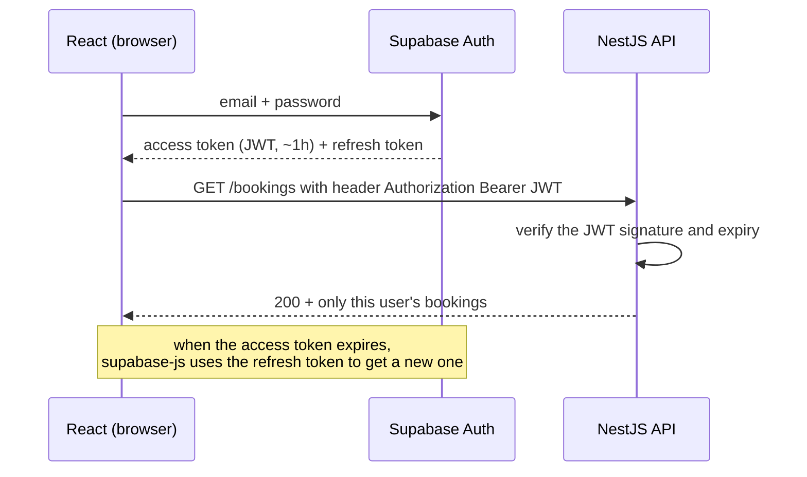
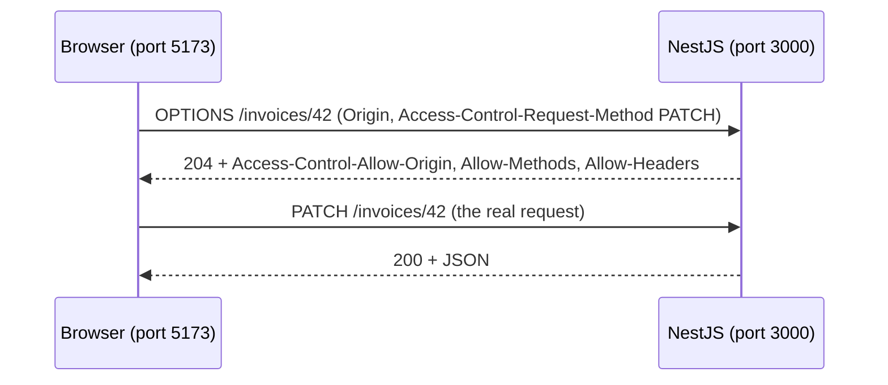

# Autentificare, cookies și CORS

HTTP e stateless, dar aplicațiile au nevoie să știe cine e logat. Aici vezi cum se rezolvă asta (sesiuni, JWT, cookies) și ce e CORS, eroarea pe care o vei întâlni sigur în prima zi de P2.

Implementarea efectivă vine mai târziu: Supabase Auth în [08-baze-de-date-supabase/06-rls-auth-storage.md](../08-baze-de-date-supabase/06-rls-auth-storage.md) și verificarea în NestJS în [07-backend-node-nest/06-guards-si-auth.md](../07-backend-node-nest/06-guards-si-auth.md). Fișierul ăsta îți dă modelul mental.

## Sesiuni vs JWT

**Ce e.** Sunt două feluri de a duce identitatea de la un request la altul.

- **Sesiune.** După login, serverul creează o sesiune în baza de date sau în memorie și trimite browserului un cookie cu un ID aleator. La fiecare request vine cookie-ul, iar serverul caută sesiunea după ID.
- **JWT (JSON Web Token).** După login, serverul de autentificare semnează un token care conține date despre utilizator (id, rol, data expirării). Clientul îl trimite la fiecare request, iar serverul verifică semnătura **fără să întrebe baza de date**.

| | Sesiune | JWT |
|---|---|---|
| unde e starea | pe server | în token, la client |
| verificare | căutare în baza de date | verificare criptografică |
| logout / revocare | ștergi sesiunea și gata | greu: token-ul e valid până expiră |
| potrivit pentru | aplicații clasice, un singur server | API-uri, mai multe servicii, mobile |

**De ce contează.** Supabase Auth, pe care îl folosești în P3 și P4, lucrează cu JWT: un **access token** de scurtă durată (implicit o oră) și un **refresh token** cu care obții un access token nou când expiră cel vechi.

**Cum îl vezi în cod real.** Fluxul din P3 Booking:



**Capcana.** Să crezi că logout-ul invalidează imediat un JWT. Token-ul rămâne valid până la expirare. De asta access token-urile trăiesc puțin.

<details>
<summary>Întrebare de interviu: Ce avantaje și dezavantaje are JWT față de sesiuni?</summary>

Avantajul JWT e că serverul îl poate verifica fără baza de date, doar din semnătură. Asta scalează bine și merge ușor între mai multe servicii. Dezavantajul e revocarea: un token furat rămâne valid până expiră. De aceea se folosesc access token-uri scurte, de minute sau o oră, plus refresh token-uri. Sesiunile se revocă ușor, pentru că ștergi rândul din baza de date, dar fiecare request înseamnă o căutare în baza de date.
</details>

## Anatomia unui JWT

**Ce e.** Trei bucăți codate base64url, separate prin puncte: `header.payload.signature`. Header-ul spune algoritmul. Payload-ul conține **claims**: `sub` (id-ul utilizatorului), `exp` (expirarea, în secunde Unix), `role`, `email`. Semnătura dovedește că token-ul a fost emis de cine are cheia și că nu a fost modificat.

**De ce contează.** Un JWT e **semnat, nu criptat**. Oricine îl poate decoda și citi.

**Exemplu minim**

```js
// decode-jwt.mjs — decoding is NOT verifying
const token =
  "eyJhbGciOiJIUzI1NiIsInR5cCI6IkpXVCJ9.eyJzdWIiOiI0MiIsInJvbGUiOiJtZW1iZXIiLCJleHAiOjE3OTQwMDAwMDB9.signature";

const payload = JSON.parse(Buffer.from(token.split(".")[1], "base64url").toString());
console.log(payload);                                  // { sub: '42', role: 'member', exp: 1794000000 }
console.log(new Date(payload.exp * 1000).toISOString()); // 2026-11-06T21:20:00.000Z
```

**Cum îl vezi în cod real.** În NestJS, un guard verifică semnătura cu cheile publice ale Supabase și abia apoi pune utilizatorul pe request. Codul exact e în [07-backend-node-nest/06-guards-si-auth.md](../07-backend-node-nest/06-guards-si-auth.md).

**Capcana.** Să decodezi token-ul și să citești `role` din el **fără să verifici semnătura**. Oricine își poate fabrica un payload cu `"role": "admin"`. Decodare ≠ verificare. Și nu pune niciodată date secrete în payload.

<details>
<summary>Întrebare de interviu: E un JWT criptat?</summary>

De obicei nu. E doar semnat: payload-ul e base64url, deci oricine îl poate citi. Semnătura garantează doar că nu a fost modificat și că a fost emis de cine are cheia. De aceea în JWT nu se pun parole sau date sensibile, iar serverul trebuie să verifice semnătura și expirarea înainte să creadă ce scrie în payload.
</details>

## Cookies

**Ce e.** Un cookie e o pereche cheie-valoare pe care serverul o setează cu headerul `Set-Cookie`. Browserul o păstrează și o **trimite automat** la fiecare request spre același site. Atributele contează:

| Atribut | Ce face |
|---|---|
| `HttpOnly` | JavaScript-ul din pagină **nu** poate citi cookie-ul, deci un script malițios nu-l poate fura |
| `Secure` | se trimite doar pe HTTPS |
| `SameSite=Lax` / `Strict` / `None` | dacă se trimite și la request-uri venite de pe alte site-uri (apărare CSRF). Browserele moderne pun implicit `Lax` |
| `Max-Age` / `Expires` | cât trăiește |
| `Path`, `Domain` | pentru ce URL-uri se trimite |

**De ce contează.** Cookie-urile sunt locul clasic pentru sesiuni. În P4, Next.js cu `@supabase/ssr` ține sesiunea tot în cookies.

**Exemplu minim**

```http
HTTP/1.1 200 OK
Set-Cookie: session=7f3a9c...; HttpOnly; Secure; SameSite=Lax; Path=/; Max-Age=86400
```

**Capcana.** `SameSite=None` funcționează doar împreună cu `Secure`, iar browserele blochează tot mai mult cookie-urile între site-uri diferite. Frontend-ul pe `vercel.app` și backend-ul pe `onrender.com` sunt site-uri diferite. Ăsta e unul dintre motivele pentru care în P3 trimiți token-ul în headerul `Authorization`, nu în cookie.

<details>
<summary>Întrebare de interviu: Ce face atributul HttpOnly pe un cookie?</summary>

Împiedică JavaScript-ul din pagină să citească cookie-ul prin `document.cookie`. Dacă un atacator reușește să injecteze un script (XSS), nu poate fura cookie-ul de sesiune. Browserul îl trimite în continuare automat la request-uri, doar codul din pagină nu are acces la el.
</details>

## Unde ții token-ul: localStorage sau cookie

**Ce e.** Când frontend-ul primește un token, trebuie să-l pună undeva.

- **`localStorage`.** Simplu, dar **orice** JavaScript din pagină îl poate citi: un XSS sau un pachet npm compromis din bundle-ul tău îl poate fura.
- **Cookie `HttpOnly`.** JavaScript-ul nu îl poate citi, deci e protejat de XSS. În schimb, fiindcă se trimite automat, ai nevoie de protecție împotriva CSRF, adică site-uri străine care declanșează request-uri în numele utilizatorului. `SameSite` rezolvă mare parte din problemă.

**De ce contează.** E o întrebare clasică de interviu, la care răspunsul bun e „depinde, și uite de ce”.

**Cum îl vezi în cod real.** Clientul Supabase din browser ține sesiunea în `localStorage` în configurația implicită. E un compromis acceptat pentru un SPA, pentru că access token-ul trăiește puțin, React face escape la text implicit (deci XSS-ul e rar) și dependențele sunt atent alese. În Next.js, `@supabase/ssr` mută sesiunea în cookies, ca serverul să o poată citi.

**Capcana.** Să alegi oricare variantă și să uiți de XSS. Un XSS reușit face rău oricum, de exemplu trimite request-uri în numele utilizatorului chiar dacă nu poate citi token-ul. Prima apărare e să nu ai XSS (vezi [10-securitate-env/04-validare-si-atacuri.md](../10-securitate-env/04-validare-si-atacuri.md)).

<details>
<summary>Întrebare de interviu: Unde ai stoca un JWT în browser?</summary>

Depinde de arhitectură. Un cookie `HttpOnly`, `Secure`, `SameSite=Lax` e mai sigur împotriva furtului prin XSS, dar cere grijă la CSRF și merge greu între domenii diferite. `localStorage` e simplu și funcționează bine cu un header `Authorization`, dar e expus dacă pagina are XSS. Pentru un SPA cu token-uri de scurtă durată, `localStorage` e un compromis acceptat. Pentru aplicații cu server rendering prefer cookies. În ambele cazuri, prioritatea e să nu ai XSS.
</details>

## CORS

**Ce e.** Browserul aplică **same-origin policy**: JavaScript-ul unei pagini de pe origin-ul A nu are voie să citească răspunsurile de la origin-ul B, decât dacă B permite explicit asta prin headerul `Access-Control-Allow-Origin`. CORS (Cross-Origin Resource Sharing) e mecanismul prin care B dă permisiunea.

Origin = protocol + host + port. Deci `http://localhost:5173` (Vite) și `http://localhost:3000` (NestJS) sunt **origin-uri diferite**. Asta e prima eroare din P2.

**De ce contează.** Esențialul despre CORS:

- e impus de **browser**, ca să **protejeze utilizatorul**: un site rău nu poate citi răspunsurile băncii tale folosind cookie-urile tale;
- **nu protejează API-ul tău**: `curl`, Postman sau un script ignoră complet CORS;
- deci CORS **nu e autentificare** și nu înlocuiește verificarea token-ului.

**Exemplu minim.** Eroarea din Console:

```text
Access to fetch at 'http://localhost:3000/clients' from origin 'http://localhost:5173'
has been blocked by CORS policy: No 'Access-Control-Allow-Origin' header is present
on the requested resource.
```

Rezolvarea în NestJS:

```ts
// main.ts
const app = await NestFactory.create(AppModule);
app.enableCors({
  origin: [process.env.FRONTEND_URL ?? "http://localhost:5173"], // the exact frontend origin(s)
});
await app.listen(process.env.PORT ?? 3000);
```

**Cum îl vezi în cod real.** În producție, `FRONTEND_URL` e adresa de pe Vercel (de exemplu `https://invoicer-xyz.vercel.app`) și se setează în variabilele de mediu de pe Render.

**Capcana.** AI-ul „rezolvă” CORS cu `origin: "*"` sau cu `app.enableCors()` fără opțiuni, care acceptă orice origin. Merge, dar orice site poate chema API-ul din browserul utilizatorilor tăi. Mai e un detaliu: la request-urile simple, browserul **trimite** request-ul și blochează doar **citirea** răspunsului. Deci CORS nu oprește efectele unui request. De asta există și apărarea CSRF.

<details>
<summary>Întrebare de interviu: Ce e CORS și de ce apare eroarea de CORS?</summary>

E un mecanism al browserului peste same-origin policy. Implicit, JavaScript-ul de pe un origin nu poate citi răspunsuri de la alt origin. Serverul poate permite asta trimițând headere ca `Access-Control-Allow-Origin`. Eroarea apare când frontend-ul și API-ul sunt pe origin-uri diferite, de exemplu alt port în dezvoltare sau alt domeniu în producție, și serverul nu a declarat frontend-ul ca permis. Se rezolvă pe server, cu origin-ul exact al frontend-ului, nu cu `*`. Și e important: CORS protejează utilizatorii din browser, nu API-ul. Pentru asta e nevoie de autentificare.
</details>

## Preflight

**Ce e.** Pentru request-urile care nu sunt „simple”, browserul întreabă întâi serverul dacă are voie. Trimite un request `OPTIONS`, numit **preflight**, și abia dacă răspunsul e favorabil trimite request-ul real. Request-ul nu mai e simplu dacă are:

- metodele `PUT`, `PATCH` sau `DELETE`;
- `Content-Type: application/json`;
- un header `Authorization` sau alt header custom.



**De ce contează.** În tab-ul Network vei vedea perechi de request-uri `OPTIONS` + `PATCH` și te vei întreba de unde vin. Acum știi.

**Capcana.** Preflight-ul pică pentru că serverul răspunde la `OPTIONS` cu `401` sau `404`, de exemplu când un guard de autentificare rulează și pe `OPTIONS`. În browser vezi „CORS error”, deși problema reală e configurarea serverului. Cu `app.enableCors()`, NestJS răspunde la preflight înainte de guards.

<details>
<summary>Întrebare de interviu: De ce văd un request OPTIONS înaintea fiecărui PATCH?</summary>

E preflight-ul CORS. Pentru request-uri care nu sunt simple (metode ca `PATCH` sau `DELETE`, body JSON, header `Authorization`), browserul întreabă întâi serverul, printr-un `OPTIONS`, dacă origin-ul, metoda și headerele sunt permise. Dacă serverul răspunde cu headerele `Access-Control-Allow-*` potrivite, browserul trimite request-ul real. Răspunsul la preflight poate fi ținut în cache prin `Access-Control-Max-Age`.
</details>

## Mai departe

- [MDN — Cross-Origin Resource Sharing (CORS)](https://developer.mozilla.org/en-US/docs/Web/HTTP/Guides/CORS)
- [MDN — Using HTTP cookies](https://developer.mozilla.org/en-US/docs/Web/HTTP/Guides/Cookies)
- [Supabase — User sessions](https://supabase.com/docs/guides/auth/sessions)
