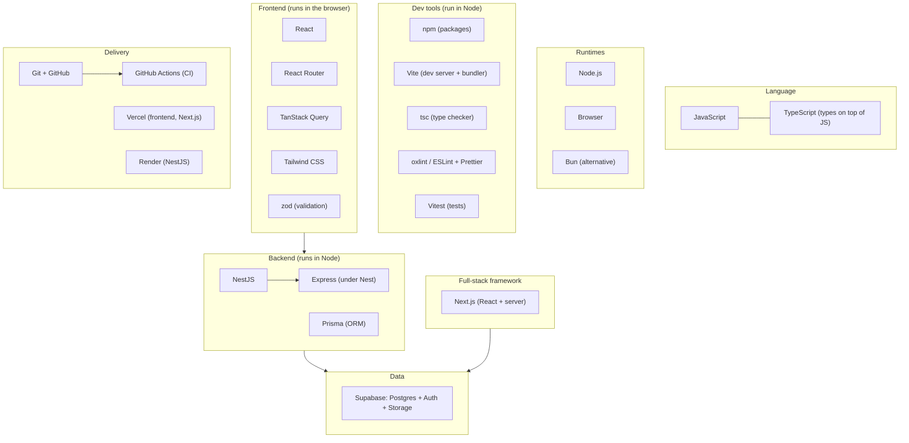

# Harta ecosistemului

Ecosistemul JavaScript pare un haos de nume: React, Vite, Nest, Next, Prisma, Supabase, zod… Aici le pui pe toate pe o hartă: ce e fiecare, unde stă și ce problemă rezolvă. Revino la fișierul ăsta ori de câte ori un nume nou te încurcă.

## Library vs framework

**Ce e.** Diferența e **cine pe cine cheamă**.

- **Library**: **tu** o chemi când ai nevoie. `zod`, `date-fns`, clientul `@anthropic-ai/sdk`.
- **Framework**: **el** te cheamă pe tine. Îți dă structura, iar tu completezi bucățile, pe care le rulează el când vrea. Asta se numește **inversion of control**, sau „principiul Hollywood”: _nu ne suna tu, te sunăm noi_.

**De ce contează.** Cu un framework, o mare parte din cod rulează „magic”, din convenții. Ca să-l depanezi, trebuie să știi convențiile: cum găsește NestJS controller-ele, cum transformă Next.js folderele în rute.

**Exemplu minim**

```ts
// Library — you are in control: you decide when parse() runs
import { z } from "zod";
const Client = z.object({ name: z.string().min(1), email: z.email() });
const client = Client.parse(input);

// Framework — NestJS is in control: it creates the class and calls findAll() on GET /clients
@Controller("clients")
export class ClientsController {
  @Get()
  findAll() {
    return [];
  }
}
// nowhere in your code do you write `new ClientsController().findAll()`
```

**Capcana.** Să cauți în cod „cine apelează funcția asta?” și să nu găsești nimic. Într-un framework, răspunsul e „framework-ul, pe baza decoratorului sau a numelui fișierului”.

<details>
<summary>Întrebare de interviu: Care e diferența dintre o bibliotecă și un framework? React e bibliotecă sau framework?</summary>

Bibliotecii îi chemi tu funcțiile, iar framework-ul îți cheamă el codul, pe baza unei structuri și a unor convenții (inversion of control). React se descrie singur ca bibliotecă pentru interfețe: se ocupă doar de componente și randare, iar routing-ul, datele și build-ul le alegi tu. Totuși, React îți cheamă componentele, deci are și ceva de framework. Next.js e un framework construit peste React: decide routing-ul, randarea pe server și structura proiectului.
</details>

## Harta



Citește harta de jos în sus pentru un request (frontend → backend → date) și de sus în jos pentru cum se construiește (limbaj → runtime → unelte → cod → livrare).

## Ce e fiecare unealtă

| Unealtă | Ce e | Unde rulează | Ce problemă rezolvă | Unde o folosești |
|---|---|---|---|---|
| **TypeScript** | JavaScript cu tipuri | la dezvoltare (dispare la build) | prinde erori înainte de runtime, autocomplete | peste tot |
| **React** | bibliotecă de UI cu componente | browser | interfețe care se actualizează singure când se schimbă datele | P1–P4 |
| **Vite** | dev server + bundler | Node (în dezvoltare) | pornire instantă, HMR, build optimizat | P1–P3 |
| **React Router** | routing în browser | browser | mai multe „pagini” într-un SPA (`/books/:id`) | P1–P3 |
| **TanStack Query** | administrare de date de pe server | browser | cache, loading, erori și reîmprospătare pentru `fetch` | P1–P3 |
| **Tailwind CSS** | CSS prin clase utilitare | build + browser | styling rapid și consistent, direct în JSX | P1–P4 |
| **zod** | validare de date cu tipuri deduse | browser și Node | verifică la runtime datele din exterior (API, formulare, AI) | P1–P4 |
| **NestJS** | framework de backend | Node | structură clară: module, controllers, services, DI | P2–P3 |
| **Express** | framework HTTP minimalist | Node | routing și middleware; NestJS îl folosește dedesubt | indirect, P2–P3 |
| **Prisma** | ORM: lucrezi cu baza de date prin obiecte TypeScript | Node | query-uri tipizate, migrații, schemă într-un fișier | P2–P3 |
| **Supabase** | platformă: Postgres + Auth + Storage + API | cloud | bază de date gestionată, autentificare gata făcută | P2–P4 |
| **Next.js** | framework full-stack peste React | Node + browser | server rendering, rute din foldere, cod de server lângă UI | P4 |
| **Vitest** | test runner | Node | rulează teste automate, atât pe frontend cât și în NestJS | P3 |
| **oxlint / ESLint** | linter | editor, CI | găsește bug-uri și tipare periculoase în cod | peste tot |
| **Prettier** | formatter | Node (editor, CI) | formatează codul la fel pentru toată lumea | peste tot |
| **GitHub Actions** | CI/CD | serverele GitHub | rulează automat lint, teste și build la fiecare PR | P3–P4 |
| **Vercel** | hosting pentru frontend și Next.js | cloud | deploy din git, preview la fiecare PR | P1–P4 |
| **Render** | hosting pentru servere | cloud | rulează backend-ul NestJS non-stop | P2–P3 |

**Capcana.** Să crezi că trebuie să știi tot din tabel în profunzime. Trebuie să știi **ce rol are** fiecare și să ai un proiect în care l-ai folosit. Adâncimea vine cu proiectele.

## ESLint vs Prettier

**Ce e.** Două unelte care se ocupă de cod fără să-l ruleze, dar cu roluri diferite:

- **Prettier** e **formatter-ul**: spații, ghilimele, lungimea liniilor, virgule. Nu-l interesează dacă codul e corect, doar să arate la fel pentru toată lumea. Discuțiile despre stil dispar din code review.
- **ESLint** e **linter-ul**: caută probleme reale, ca variabile nefolosite, `await` uitat sau dependențe lipsă la un hook React. Unele reguli prind bug-uri adevărate.

Le folosești împreună: Prettier formatează, ESLint verifică. Pachetul `eslint-config-prettier` dezactivează regulile de formatare din ESLint, ca să nu se certe cele două.

**De ce contează.** În orice echipă, CI-ul rulează linter-ul la fiecare PR. Cod care nu trece lint-ul nu intră în `main`.

**Exemplu minim**

```ts
// Prettier would only re-format this line (quotes, spacing)
const total=lines.reduce((s,l)=>s+l.cents,0)

// ESLint would complain about real problems
async function load() {
  const unused = 42;   // no-unused-vars: declared but never used
  fetchBooks();        // no-floating-promises (with TS rules): promise is not awaited or handled
}
```

**Cum îl vezi în cod real.** Atât șablonul Vite actual, cât și `nest new` vin cu **oxlint** în loc de ESLint. E un linter scris în Rust, mult mai rapid, cu reguli compatibile cu cele din ESLint, deci rolul e exact același. NestJS îl pune lângă Prettier. ESLint rămâne totuși cel mai răspândit linter în proiectele existente, deci la job îl vei întâlni des. O să mai auzi și de **Biome**, care face și lint, și formatare într-o singură unealtă. Contează să știi ce rol joacă fiecare, nu numele.

În VS Code setezi „Format on Save” cu Prettier și instalezi extensia linter-ului folosit de proiect, ca să vezi problemele direct în editor (vezi [01-setup/04-vscode.md](../01-setup/04-vscode.md)).

**Capcana.** Să ignori warning-urile de lint, mai ales `react-hooks/exhaustive-deps`. Ăla nu e o chestiune de stil, e aproape mereu un bug cu date vechi într-un efect (vezi [06-react/04-efecte.md](../06-react/04-efecte.md)).

<details>
<summary>Întrebare de interviu: Care e diferența dintre ESLint și Prettier?</summary>

Prettier e un formatter: rescrie codul ca să arate uniform și nu se uită la logică. ESLint e un linter: analizează codul și găsește probleme sau tipare riscante, ca variabile nefolosite, promisiuni neașteptate sau dependențe greșite la hook-uri. Se folosesc împreună, Prettier pentru formă și ESLint pentru corectitudine, iar ambele rulează în editor și în CI.
</details>

## Cum citești un proiect necunoscut în 5 minute

**Ce e.** Prima zi pe un proiect la job, sau prima privire pe un repo de pe GitHub:

1. **README**: ce face și cum îl pornești.
2. **`package.json`**: `scripts` îți arată comenzile, `dependencies` îți arată stack-ul.
3. **Lockfile-ul**: ce package manager folosește.
4. **Punctul de intrare**: `src/main.tsx` (Vite), `src/main.ts` (NestJS), `app/` (Next.js).
5. **Urmărești un singur request** de la UI până în baza de date, ca în [02-cum-functioneaza-webul/04-frontend-vs-backend.md](../02-cum-functioneaza-webul/04-frontend-vs-backend.md).

**Exemplu minim.** Dependențele unui backend, fără versiuni:

```text
@nestjs/common  @nestjs/core  @nestjs/platform-express  @nestjs/config  @nestjs/swagger
@prisma/client  class-validator  class-transformer  reflect-metadata  rxjs
```

Din lista asta știi deja: NestJS peste Express, configurare din env, documentație Swagger, Prisma pentru baza de date, validare cu class-validator. Asta e exact stack-ul din P2.

**Capcana.** Să citești codul fișier cu fișier, în ordine alfabetică. Urmărește un flux. Și întreabă-l pe Claude: _„Care e stack-ul proiectului ăsta și cum curge un request prin el?”_, apoi verifici ce ți-a spus.

<details>
<summary>Întrebare de interviu: Cum te apuci de un proiect nou într-o echipă?</summary>

Citesc README-ul și pornesc proiectul local. Mă uit în `package.json` după scripturi și stack. Găsesc punctul de intrare și urmăresc un flux complet, de exemplu un request de la UI până în baza de date. Apoi iau un task mic, ca un bug sau un text de schimbat, ca să trec prin tot ciclul: branch, cod, teste, PR, review. Întreb devreme când ceva nu e clar, în loc să ghicesc.
</details>

## Nume pe care le vei auzi, dar nu le folosim (încă)

| Nume | Ce e, într-o frază |
|---|---|
| webpack | bundler-ul clasic, încă prezent în multe proiecte mai vechi |
| Yarn | alt package manager, popular înainte de pnpm |
| Fastify | alternativă mai rapidă la Express; NestJS poate rula și peste el |
| Drizzle, TypeORM | alternative la Prisma; Drizzle seamănă mai mult cu SQL |
| Redux, Zustand | biblioteci de state global în React (TanStack Query acoperă partea de date de pe server) |
| Jest | test runner-ul clasic, încă prezent în multe proiecte NestJS și React mai vechi; Vitest are aproape același API |
| Playwright | teste end-to-end care controlează un browser real |
| Docker | împachetează o aplicație cu tot mediul ei într-un container |
| Turborepo, Nx | unelte pentru monorepo-uri |
| GraphQL, tRPC | alternative la REST pentru API-uri |
| shadcn/ui | componente React gata făcute, pe care le copiezi în proiect (des folosite cu Tailwind) |

## Mai departe

- [React — Learn](https://react.dev/learn)
- [NestJS — First steps](https://docs.nestjs.com/first-steps)
- [ESLint — Getting started](https://eslint.org/docs/latest/use/getting-started)
