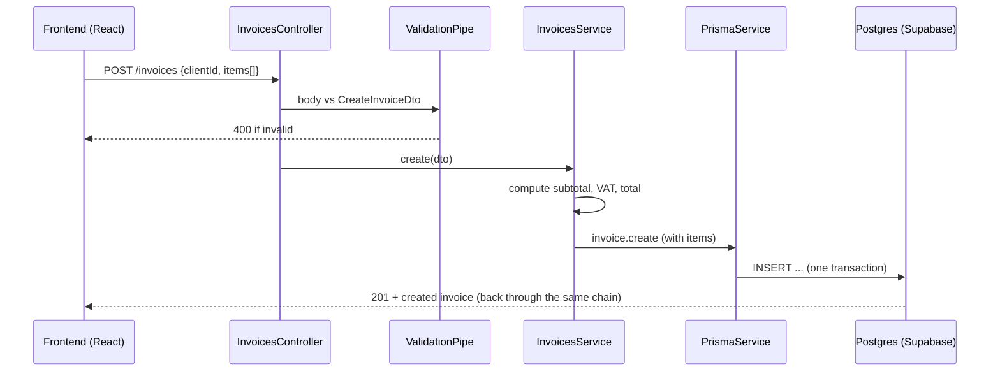

# Arhitectura Nest

Nest are patru piese pe care le vei vedea în fiecare fișier: module, controllers, providers (services) și dependency injection. Dacă le înțelegi, poți citi orice proiect Nest, inclusiv ce generează Claude în P2.

## Proiectul nou, cu CLI-ul

**Pașii** (în WSL, în `~/code`):

```bash
npm i -g @nestjs/cli
nest new invoicer-api
```

CLI-ul te întreabă ce package manager vrei (alege `npm`) și ce sistem de module (lasă default-ul, **ESM**, care vine cu Vitest pentru teste). Apoi:

```bash
cd invoicer-api
npm run start:dev   # starts the server and restarts it on every file change
curl localhost:3000 # -> Hello World!
```

**Verifică.** Vezi `Nest application successfully started` în terminal și `Hello World!` la curl.

**Ce s-a întâmplat de fapt.** CLI-ul a creat un proiect TypeScript cu `src/main.ts` (pornește aplicația), `src/app.module.ts` (modulul rădăcină), un controller, un service și un test. `start:dev` compilează TypeScript-ul și repornește serverul la fiecare salvare. În `package.json` mai găsești `npm run lint` (proiectele noi vin cu oxlint, un linter foarte rapid), `npm test` (Vitest) și `npm run build`. Adaugă tu un script `"typecheck": "tsc --noEmit"`, pentru că CI-ul din [09/05](../09-git-github-echipa/05-conventii-si-ci.md) rulează `lint`, `typecheck` și `test`.

**Capcana.** CLI-ul Nest cere o versiune recentă de Node. Dacă `nest new` dă erori ciudate, verifică `node -v` și instalează LTS-ul cu `fnm` (vezi [01-setup/03](../01-setup/03-node-npm-bun.md)).

## De ce `.js` în importuri, într-un fișier `.ts`

În proiectele ESM o să vezi asta peste tot:

```ts
import { AppModule } from './app.module.js'; // the file on disk is app.module.ts
```

TypeScript se compilează în JavaScript, iar Node rulează fișierele `.js` rezultate. În ESM, Node cere extensia exactă în importurile relative, deci scrii extensia pe care o va avea fișierul *după* compilare. Arată ciudat prima dată, dar e corect. Dacă Claude scrie un import relativ fără `.js` și aplicația cade la pornire cu `ERR_MODULE_NOT_FOUND`, asta e cauza.

## Module

**Ce e.** Un modul grupează tot ce ține de o funcționalitate: controller-ul, service-ul și ce alte module folosește. `AppModule` e rădăcina și importă restul.

**De ce contează.** Când deschizi un proiect Nest, folderele din `src/` sunt modulele: `clients/`, `invoices/`, `payments/`. Știi imediat unde e codul pentru facturi.

**Exemplu minim:**

```ts
// src/invoices/invoices.module.ts
import { Module } from '@nestjs/common';
import { InvoicesController } from './invoices.controller.js';
import { InvoicesService } from './invoices.service.js';

@Module({
  controllers: [InvoicesController], // handle HTTP requests
  providers: [InvoicesService],      // classes Nest creates and injects
  exports: [InvoicesService],        // other modules may use this service
})
export class InvoicesModule {}
```

**Capcana.** Dacă un service din alt modul nu e în `exports`-ul modulului lui, sau modulul nu e în `imports`, Nest cade la pornire cu `Nest can't resolve dependencies of ...`. Mesajul îți spune exact ce lipsește și unde. Citește-l până la capăt.

## Controllers

**Ce e.** Clasa care primește request-uri HTTP. Fiecare metodă e legată de o rută prin decoratori: `@Get()`, `@Post()`, `@Patch(':id')`, `@Delete(':id')`. Parametrii se scot cu `@Param()`, `@Query()`, `@Body()`.

**Regula.** Controller-ul e subțire. Citește ce a venit, cheamă service-ul și returnează. Fără logică de business și fără acces la baza de date.

```ts
@Controller('invoices')
export class InvoicesController {
  constructor(private readonly invoicesService: InvoicesService) {}

  @Get()
  findAll(@Query('status') status?: InvoiceStatus) {
    return this.invoicesService.findAll(status); // GET /invoices?status=SENT
  }
}
```

Ce returnezi dintr-o metodă (obiect, array) Nest serializează automat în JSON. Status-ul implicit e 200, sau 201 pentru `POST`.

## Providers și services

**Ce e.** Un provider e orice clasă pe care Nest o poate crea și injecta. Cel mai des e un **service**: clasa cu logica de business. Calculează totaluri, verifică reguli, vorbește cu baza de date prin Prisma.

**Exemplu minim:**

```ts
@Injectable()
export class InvoicesService {
  constructor(private readonly prisma: PrismaService) {}

  async findOne(id: string) {
    const invoice = await this.prisma.invoice.findUnique({ where: { id }, include: { items: true } });
    if (!invoice) throw new NotFoundException(`Invoice ${id} not found`);
    return invoice;
  }
}
```

**De ce contează.** Logica stă într-un singur loc. Același `InvoicesService.create()` poate fi chemat dintr-un controller HTTP, dintr-un job programat sau dintr-un test, fără să copiezi cod.

## Dependency injection

**Ce e.** În loc să scrii `new PrismaService()` în fiecare service, *declari* în constructor de ce ai nevoie, iar Nest creează obiectele și ți le dă. Fiecare provider e creat o singură dată (singleton) și refolosit.

**Analogie.** E ca la brigadă: bucătarul de la garnituri nu-și cumpără singur legumele. Scrie pe listă ce-i trebuie, iar cineva i le aduce la post. El nu știe și nu-l interesează de la ce furnizor vin.

**De ce contează.**

- **La teste.** Îi dai service-ului un Prisma fals (mock) în loc de cel real, fără să schimbi codul service-ului. Vezi [07-teste](07-teste.md).
- **La citit cod.** Constructorul îți spune din prima linie de ce depinde o clasă.

```ts
constructor(
  private readonly prisma: PrismaService,        // Nest finds PrismaService in the module graph
  private readonly config: ConfigService,        // ...and ConfigService
) {}
```

**Capcana.** Dependențele circulare: `InvoicesService` cere `PaymentsService`, care cere `InvoicesService`. Nest cade la pornire. De obicei e semn că logica comună trebuie mutată într-un al treilea service. `forwardRef()` există, dar e un plasture, nu o soluție.

<details>
<summary>Întrebare de interviu: Ce e dependency injection și de ce îl folosește Nest?</summary>

E un tipar în care o clasă nu-și creează singură dependențele, ci le primește din afară, de obicei prin constructor. În Nest, containerul de DI vede ce cere fiecare constructor, creează provider-ii o singură dată și îi injectează. Avantajele: clasele sunt decuplate, pot înlocui ușor o dependență cu un mock în teste și văd din constructor exact de ce depinde o clasă.
</details>

## Harta unui modul: `invoices` din P2

`nest g resource invoices` (alegi „REST API” și „Yes” la CRUD) generează scheletul. După ce îl completezi, arată așa:

```
src/
├── main.ts                      bootstrap: creates the app, global pipes, CORS, Swagger
├── app.module.ts                root: imports ConfigModule, PrismaModule, feature modules
├── prisma/
│   ├── prisma.module.ts
│   └── prisma.service.ts        the database client, injected everywhere
└── invoices/
    ├── invoices.module.ts
    ├── invoices.controller.ts   routes: GET/POST /invoices, GET/PATCH/DELETE /invoices/:id
    ├── invoices.service.ts      business logic: totals, numbering, status rules
    ├── invoices.service.spec.ts unit tests for the service
    └── dto/
        ├── create-invoice.dto.ts   shape + validation of POST body
        └── update-invoice.dto.ts
```

Drumul unui `POST /invoices`:



**Capcana cu `nest g resource`.** Generează și un folder `entities/` cu o clasă goală. Cu Prisma nu ai nevoie de ea, pentru că tipurile vin din clientul generat de Prisma. Șterge-o, ca să nu ai două surse pentru aceeași formă de date.

<details>
<summary>Întrebare de interviu: Care e diferența dintre un controller și un service?</summary>

Controller-ul e stratul HTTP: primește request-ul, extrage parametrii și body-ul, cheamă service-ul și returnează răspunsul. Service-ul conține logica de business și accesul la date, și nu știe nimic despre HTTP. Separarea mă lasă să refolosesc logica din alte locuri, de exemplu dintr-un job programat, și să testez service-ul fără server.
</details>

## Mai departe

- [NestJS — Modules](https://docs.nestjs.com/modules)
- [NestJS — Providers](https://docs.nestjs.com/providers)
- [NestJS — CLI: generate](https://docs.nestjs.com/cli/usages#nest-generate)
