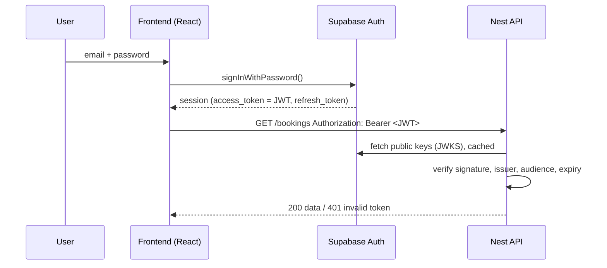

# Guards și auth

În P3, user-ii au conturi. Login-ul îl face Supabase Auth în frontend, dar backend-ul trebuie să verifice la fiecare request *cine* e user-ul (autentificare) și *ce are voie* să facă (autorizare). În Nest, asta se face cu guards. Diferența dintre cele două concepte e explicată pe larg în [10-securitate-env/05](../10-securitate-env/05-autentificare-vs-autorizare.md).

## Ciclul de viață al unui request în Nest

**Ce e.** Ordinea fixă prin care trece fiecare request:

```
request
  → middleware        (logging, raw request tweaks)
  → guards            (may this request proceed at all? auth, roles)
  → interceptors      (before: timing, caching)
  → pipes             (validate/transform params and body: ValidationPipe)
  → controller handler → service
  → interceptors      (after: transform the response)
  → exception filters (only if something threw)
response
```

**De ce contează.** Când ceva „nu ajunge în controller”, știi unde să cauți. Un 401/403 vine dintr-un guard, un 400 dintr-un pipe, iar un răspuns cu format ciudat dintr-un interceptor sau filter.

**Capcana.** Guards rulează *înaintea* pipes. Deci într-un guard body-ul nu e încă validat. Nu lua decizii de securitate pe baza body-ului acolo.

<details>
<summary>Întrebare de interviu: Care e diferența dintre middleware, guard, interceptor și pipe în Nest?</summary>

Middleware-ul rulează primul și lucrează cu request-ul brut, de exemplu pentru logging. Guard-ul decide dacă request-ul are voie să continue: autentificare, roluri. Interceptorul înfășoară handler-ul și poate face ceva înainte și după, de exemplu măsoară durata sau transformă răspunsul. Pipe-ul validează și transformă datele de intrare înainte să ajungă în handler, ca `ValidationPipe`. Ordinea e: middleware, guards, interceptors, pipes, handler, apoi interceptors și, la erori, exception filters.
</details>

## Fluxul de auth din P3



**Ce să observi.** Nest nu vede niciodată parola. Primește doar un JWT semnat de Supabase și verifică semnătura cu cheia publică a proiectului. Dacă token-ul a fost modificat sau a expirat, semnătura nu se mai potrivește și request-ul e respins.

## Guard-ul care verifică JWT-ul

**Ce e.** Un guard e o clasă cu metoda `canActivate()`. Returnează `true` ca request-ul să meargă mai departe, sau aruncă o excepție (ori returnează `false`, iar atunci Nest răspunde cu 403).

**Prerechizită în Supabase.** Proiectul trebuie să folosească **signing keys asimetrice**: Supabase semnează cu o cheie privată, iar tu verifici cu cea publică. Cheile publice stau la un URL public (JWKS). Verifică:

```bash
curl https://<project-ref>.supabase.co/auth/v1/.well-known/jwks.json
```

Dacă primești un array `keys` gol, proiectul folosește încă vechiul secret partajat (HS256). Mergi în dashboard la pagina **JWT Keys** a proiectului, apasă „Migrate JWT secret”, apoi „Rotate keys”.

**Exemplu** (`npm i jose`):

```ts
// src/auth/supabase-auth.guard.ts
import { CanActivate, ExecutionContext, Injectable, UnauthorizedException } from '@nestjs/common';
import { ConfigService } from '@nestjs/config';
import { createRemoteJWKSet, jwtVerify } from 'jose';

@Injectable()
export class SupabaseAuthGuard implements CanActivate {
  private readonly issuer: string;
  private readonly jwks: ReturnType<typeof createRemoteJWKSet>;

  constructor(config: ConfigService) {
    this.issuer = `${config.getOrThrow<string>('SUPABASE_URL')}/auth/v1`; // https://<ref>.supabase.co/auth/v1
    this.jwks = createRemoteJWKSet(new URL(`${this.issuer}/.well-known/jwks.json`)); // keys are fetched and cached
  }

  async canActivate(context: ExecutionContext): Promise<boolean> {
    const request = context.switchToHttp().getRequest();
    const [type, token] = request.headers.authorization?.split(' ') ?? [];
    if (type !== 'Bearer' || !token) throw new UnauthorizedException('Missing token');

    try {
      const { payload } = await jwtVerify(token, this.jwks, {
        issuer: this.issuer,
        audience: 'authenticated', // signed-in users; anonymous users get "anon"
      });
      request.user = { id: payload.sub, email: payload.email };
      return true;
    } catch {
      throw new UnauthorizedException('Invalid or expired token');
    }
  }
}
```

Și un decorator mic, ca să iei user-ul curat în controller:

```ts
export const CurrentUser = createParamDecorator(
  (_data: unknown, ctx: ExecutionContext) => ctx.switchToHttp().getRequest().user,
);

// usage
@UseGuards(SupabaseAuthGuard)
@Get('me/bookings')
myBookings(@CurrentUser() user: { id: string }) {
  return this.bookingsService.findForUser(user.id);
}
```

**Capcana.** Codul generat de AI face uneori `jwt.decode(token)` și citește `sub` fără să verifice semnătura. Asta e ca și cum ai citi un bon scris de mână de client, fără ștampilă. Oricine poate fabrica un token cu orice `sub`. Verificarea semnăturii (`jwtVerify`) e partea care contează. Dacă vezi `decode` fără `verify`, e un bug de securitate.

<details>
<summary>Întrebare de interviu: Cum verifici un JWT pe backend?</summary>

Un JWT are trei părți: header, payload și semnătură. Payload-ul e doar codat în base64, deci oricine îl poate citi și modifica. De aceea verific semnătura cu cheia publică a emitentului, pe care o iau de la endpoint-ul JWKS și o țin în cache. Apoi verific claim-urile: `iss` (emitentul corect), `aud` (audiența) și `exp` (să nu fi expirat). Abia după asta am încredere în `sub`, adică id-ul user-ului.
</details>

## Roluri: `@Roles` și `RolesGuard`

**Ce e.** Autentificarea îți spune *cine* e. Rolul îți spune *ce* poate face. În P3: `admin` gestionează sălile și programul, iar `member` face rezervări.

**Unde stă rolul.** Într-un tabel `profiles` din baza ta, cu `id` = id-ul user-ului din Supabase Auth și o coloană `role`. **Nu** în `user_metadata`, pentru că user-ul își poate modifica singur metadata din frontend, deci și-ar putea da singur rol de admin.

**Exemplu:**

```ts
// src/auth/roles.decorator.ts
export const Roles = Reflector.createDecorator<Role[]>(); // Role = 'admin' | 'member'

// src/auth/roles.guard.ts
@Injectable()
export class RolesGuard implements CanActivate {
  constructor(private readonly reflector: Reflector, private readonly prisma: PrismaService) {}

  async canActivate(context: ExecutionContext): Promise<boolean> {
    const required = this.reflector.get(Roles, context.getHandler());
    if (!required) return true; // route has no @Roles -> any authenticated user

    const { user } = context.switchToHttp().getRequest();
    const profile = await this.prisma.profile.findUnique({ where: { id: user.id }, select: { role: true } });
    return !!profile && required.includes(profile.role); // false -> 403 Forbidden
  }
}

// usage
@UseGuards(SupabaseAuthGuard, RolesGuard) // order matters: first who are you, then what may you do
@Controller('resources')
export class ResourcesController {
  @Roles(['admin'])
  @Post()
  create(@Body() dto: CreateResourceDto) { /* ... */ }
}
```

**Capcana.** Ordinea din `@UseGuards` contează. Dacă `RolesGuard` rulează primul, `request.user` nu există încă și primești un crash, nu un 401.

## Verificarea de ownership

**Ce e.** Rolul nu e suficient. Un `member` are voie să-și anuleze rezervările *lui*, nu pe ale altora. Verificarea asta se face în service, pe fiecare resursă.

**Exemplu:**

```ts
async cancel(bookingId: string, user: { id: string }, isAdmin: boolean) {
  const booking = await this.prisma.booking.findUnique({ where: { id: bookingId } });
  if (!booking) throw new NotFoundException();
  if (booking.userId !== user.id && !isAdmin) {
    throw new ForbiddenException('You can only cancel your own bookings');
  }
  return this.prisma.booking.delete({ where: { id: bookingId } });
}
```

**Capcana.** Asta e cea mai frecventă vulnerabilitate în aplicațiile scrise de juniori (și de AI): **IDOR** (Insecure Direct Object Reference). Endpoint-ul verifică dacă ești logat, dar nu verifică dacă resursa e a ta. Schimbi id-ul din URL și vezi sau ștergi datele altcuiva. La fiecare endpoint care primește un id, pune-ți întrebarea: „cine are voie la resursa asta?”.

<details>
<summary>Întrebare de interviu: Ce e IDOR și cum îl previi?</summary>

Insecure Direct Object Reference: un endpoint primește id-ul unei resurse și o returnează sau o modifică fără să verifice că user-ul curent are drept asupra ei. De exemplu, `DELETE /bookings/123` șterge rezervarea oricui, dacă știi id-ul. Îl previn verificând ownership-ul la fiecare acces: compar `userId`-ul resursei cu user-ul din token, sau filtrez direct în query (`where: { id, userId }`). Id-urile UUID îl fac mai greu de exploatat, dar nu sunt o protecție. Verificarea e protecția.
</details>

## Mai departe

- [NestJS — Guards](https://docs.nestjs.com/guards)
- [NestJS — Request lifecycle](https://docs.nestjs.com/faq/request-lifecycle)
- [Supabase — JSON Web Tokens](https://supabase.com/docs/guides/auth/jwts)
