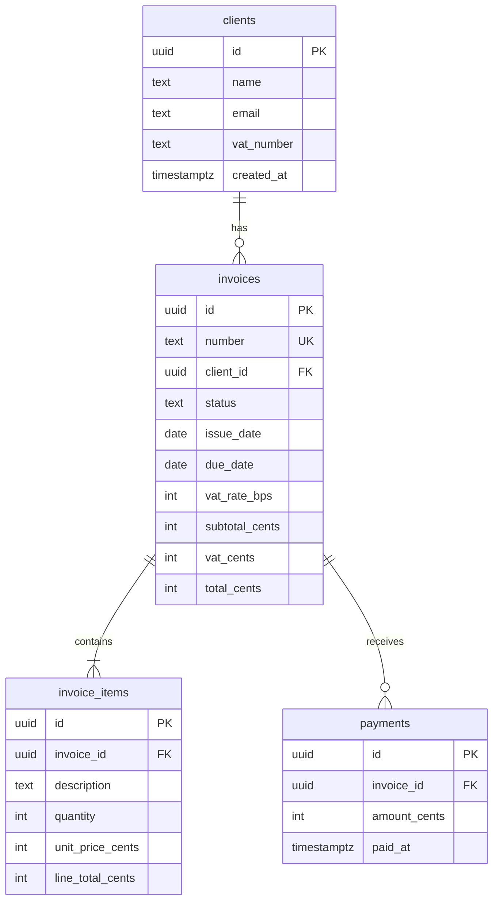
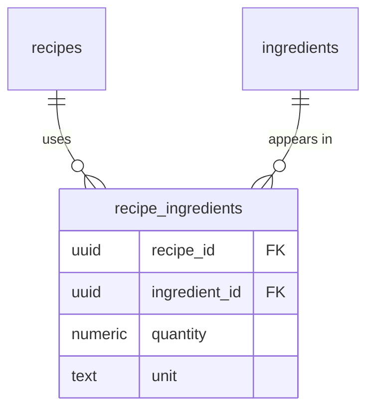

# Modelul relațional

O bază de date relațională ține datele în tabele legate între ele prin chei. Modelul are peste 50 de ani și e încă standardul, pentru că garantează lucruri pe care codul singur nu le poate garanta: că nu există o factură fără client, că un email nu apare de două ori, că datele rămân consistente când scriu 100 de oameni deodată.

## Tabele, rânduri, coloane, tipuri

**Ce e.** Un **tabel** e o colecție de lucruri de același fel (`clients`, `invoices`). Fiecare **rând** e un lucru (un client), iar fiecare **coloană** e o proprietate cu un **tip** fix. Spre deosebire de un obiect JavaScript, toate rândurile au exact aceleași coloane, iar baza de date refuză un `"abc"` într-o coloană numerică.

**Tipurile Postgres pe care le vei folosi cel mai des:**

| Tip | Pentru ce | Exemplu |
|---|---|---|
| `text` | orice șir de caractere | nume, email, descriere |
| `integer` / `bigint` | numere întregi | cantități, **bani în bani/cenți** |
| `numeric(10,2)` | zecimale exacte | cantități fracționare (0,75 kg) |
| `boolean` | da/nu | `is_active` |
| `date` | doar data | `due_date` |
| `timestamptz` | moment exact în timp, cu fus orar | `created_at`, începutul unei rezervări |
| `uuid` | id unic global | chei primare |
| `jsonb` | JSON structurat, interogabil | răspunsul brut de la AI în P4 |

**Capcana.** `timestamp` (fără `tz`) nu știe de fus orar. O rezervare la „10:00” salvată de pe un server din Frankfurt și citită de pe unul din SUA ajunge la altă oră. Pentru momente în timp folosești mereu `timestamptz`.

## Cheia primară (primary key)

**Ce e.** Coloana care identifică unic fiecare rând. Nu se repetă, nu e niciodată goală și nu se schimbă.

**Două variante uzuale:**

- **`bigint generated always as identity`:** 1, 2, 3... Simplu și compact.
- **`uuid`:** `3f2b8c1e-...`. Nu se poate ghici și poate fi generat oriunde, inclusiv în frontend. În proiectele tale folosești `uuid`, ca și Supabase Auth pentru user-i.

**Capcana.** Nu folosi ca cheie primară ceva „natural” care se poate schimba: emailul, CUI-ul, numărul de telefon. Clientul își schimbă emailul și toate legăturile se rup.

## Cheia străină (foreign key) și relația 1-n

**Ce e.** O coloană care arată spre cheia primară din alt tabel. `invoices.client_id` arată spre `clients.id`. Baza de date garantează că valoarea există: nu poți crea o factură pentru un client inexistent, și nu poți șterge un client care are facturi (dacă nu spui explicit altceva).

**Relația 1-n (one-to-many).** Un client are **mai multe** facturi, iar o factură are **un singur** client. Foreign key-ul stă mereu pe partea „mulți”: `client_id` e în `invoices`, nu invers.

**Schema din P2:**

`||--o{` se citește „unul la zero sau mai mulți”, iar `||--|{` „unul la unul sau mai mulți” (o factură are cel puțin o linie).

**Ce să observi.** Ce se întâmplă la ștergere se decide pe fiecare relație. Liniile facturii se șterg împreună cu factura (`ON DELETE CASCADE`), pentru că n-au sens singure. Un client cu facturi **nu** se poate șterge, pentru că facturile sunt documente contabile. Asta e o decizie de business, scrisă în schemă.

Întrebare de interviu: Ce e o foreign key și de ce n-o verifici doar în cod?

E o coloană care referă cheia primară din alt tabel și pe care baza de date o garantează: nu poate exista o valoare care nu are corespondent. În cod aș putea verifica, dar codul are bug-uri, mai multe servicii pot scrie în aceeași bază, iar două request-uri simultane pot trece amândouă de verificare. Constrângerea din baza de date e singurul loc care garantează consistența indiferent cine scrie. Bonus: documentează relațiile direct în schemă.

## Relația n-n, cu tabel de legătură

**Ce e.** O rețetă are mai multe ingrediente, iar un ingredient apare în mai multe rețete. Nicio parte nu poate ține un singur foreign key, așa că apare un al treilea tabel care ține perechile. Bonus: tabelul ăsta poate ține și date despre relație, cum ar fi cantitatea.

**Exemplu din P4:**

Cheia primară a tabelului de legătură e de obicei perechea `(recipe_id, ingredient_id)`, ca același ingredient să nu apară de două ori în aceeași rețetă.

**Capcana.** Tentația de începător (și uneori a AI-ului) e o coloană `ingredients text[]` sau `jsonb` în `recipes`. Merge până vrei să afli „în ce rețete apare untul” sau să actualizezi prețul untului peste tot. Atunci te lovești de pereți.

## Normalizare (pe scurt)

**Ce e.** Principiul „fiecare fapt e scris într-un singur loc”. Numele clientului stă în `clients`, nu copiat în fiecare factură. Dacă se schimbă, îl schimbi o dată.

**De ce contează.** Datele duplicate ajung inevitabil să nu se mai potrivească între ele. Jumătate din bug-urile de date din aplicațiile reale vin de aici.

**Excepția conștientă.** O factură emisă e un document legal: dacă firma clientului își schimbă adresa, factura veche trebuie să arate adresa de *atunci*. Acolo copiezi intenționat datele clientului în factură, la emitere. Asta se numește denormalizare și e o decizie, nu o scăpare. La interviu, să știi să spui *când* încalci o regulă valorează mai mult decât să știi regula.

## Schemă Postgres

**Ce e.** Un spațiu de nume (namespace) pentru tabele, ca un folder în interiorul bazei de date. Tabelul `invoices` din schema `invoicer` se scrie complet `invoicer.invoices`. Dacă nu scrii schema, Postgres caută în `search_path`, care implicit e `public`.

**Ce scheme vei vedea în Supabase:**

- **`public`:** schema implicită. E expusă prin Data API, de aceea are nevoie de RLS (vezi [06](06-rls-auth-storage.md));
- **`auth`, `storage`:** gestionate de Supabase (user-ii, fișierele). Le citești, dar nu le modifici;
- **schemele tale:** `invoicer` (P2), `booking` (P3), `sandbox` (pentru exercițiile din [02](02-sql-esential.md)).

**De ce contează la tine.** P2 și P3 împart același proiect Supabase (vezi [03](03-cont-supabase.md#planul-două-proiecte-supabase-în-total)), dar fiecare are schema lui. Tabelele nu se amestecă, iar migrațiile unuia nu le ating pe ale celuilalt. Bonus de securitate: o schemă proprie **nu e expusă implicit prin Data API**, spre deosebire de `public`, deci cheia publishable din frontend nu ajunge la ea deloc.

**Capcana.** Dacă un query dă `relation "invoices" does not exist`, deși vezi tabelul în Table Editor, aproape sigur rulezi în altă schemă decât crezi. Scrie numele complet (`invoicer.invoices`) sau verifică schema selectată sus-stânga în Table Editor.

## Indecși

**Ce e.** O structură separată, ca indexul de la finalul unei cărți, care îi permite bazei de date să găsească rânduri fără să citească tot tabelul. Cheile primare și coloanele `UNIQUE` au index automat.

**Când pui un index:**

- pe foreign keys (`invoices.client_id`): Postgres **nu** le indexează automat, și le folosești la fiecare JOIN;
- pe coloanele după care filtrezi des (`WHERE status = 'SENT' AND due_date < now()`);
- pe coloanele după care sortezi liste mari.

**De ce nu pe toate coloanele.** Fiecare index încetinește scrierile (și el trebuie actualizat) și ocupă spațiu. Îl pui unde ai un query real care are nevoie de el.

Întrebare de interviu: Ce e un index și care e costul lui?

E o structură de date, de obicei un B-tree, care permite găsirea rapidă a rândurilor după valorile unei coloane, fără scanarea întregului tabel. Transformă căutări de la timp liniar la logaritmic. Costul: fiecare INSERT, UPDATE și DELETE trebuie să actualizeze și indexul, deci scrierile devin mai lente, și ocupă spațiu. Pun indecși pe foreign keys și pe coloanele folosite des în WHERE și ORDER BY, și verific cu `EXPLAIN` că query-ul chiar îl folosește.

## Mai departe

- [PostgreSQL — Data types](https://www.postgresql.org/docs/current/datatype.html)
- [Supabase — Tables and data](https://supabase.com/docs/guides/database/tables)
