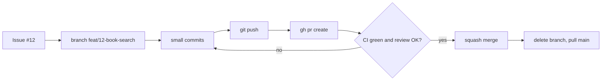
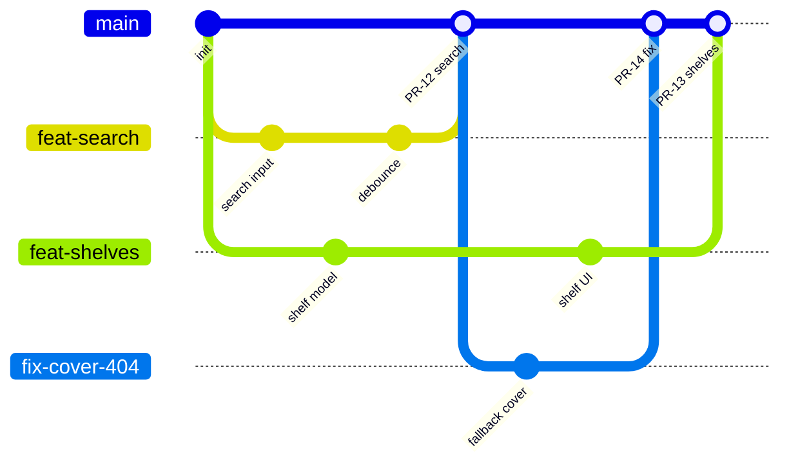

# Pull requests: cum ajunge codul pe main

Un pull request (PR) e o cerere de genul: „vreau să unesc branch-ul meu în `main`, uitați-vă peste el”. Pe PR se face review-ul, tot acolo rulează CI-ul și tot acolo se discută deciziile. Într-o echipă, aici se petrece cea mai mare parte a colaborării.

## Fluxul complet, de la issue la main

**Ce e.** Același drum pentru orice schimbare, de la un typo la un feature mare.



**Comenzile, pas cu pas**

```bash
# 0. The issue: what needs doing and why (teams always start here)
gh issue create --title "Search books by title" --body "As a reader I can search by title and see covers."
# GitHub gives it a number, say #12

# 1. Fresh main, new branch
git switch main
git pull
git switch -c feat/12-book-search

# 2. Small commits as you work
git add src/features/search/
git commit -m "feat(search): add search input with debounce"

# 3. Push the branch (-u links it to the remote branch the first time)
git push -u origin HEAD

# 4. Open the PR
gh pr create --fill            # title and body from your commits, edit after
# or: gh pr create --draft     # not ready for review yet, but CI runs

# 5. Follow CI and review. Fixes go as new commits on the same branch.
gh pr checks                   # CI status
gh pr view --web               # open the PR in the browser

# 6. Merge after approval and green CI
gh pr merge --squash --delete-branch

# 7. Back on an up-to-date main
git switch main
git pull
```

Dacă scrii `Closes #12` în descrierea PR-ului, GitHub închide automat issue-ul la merge.

**De ce contează.** E fluxul pe care îl vei folosi zilnic la orice job. La interviu, cine îl poate povesti natural sună ca cineva care a lucrat deja într-o echipă.

**Capcana.** Să lucrezi direct pe `main` „pentru că e o schimbare mică”. Pe repo-urile tale din P3 o să protejezi `main` ([05](05-conventii-si-ci.md)), iar GitHub nici nu te mai lasă să faci asta.

## Cum scrii descrierea unui PR

**Ce e.** Descrierea e mesajul către reviewer. Un PR fără descriere îl obligă pe reviewer să ghicească ce ai vrut să faci.

**Exemplu minim** (descrierile sunt în engleză, ca și codul):

```markdown
## What
Search books by title using the Open Library API, with debounced input and loading/error states.

## Why
Closes #12. First step towards adding books to shelves.

## How to test
1. `npm run dev`, open /search
2. Type "dune": results appear after you stop typing
3. Turn off Wi-Fi and search again: an error message appears, no crash

## Notes
- Debounce is 300 ms, chosen by feel. Happy to change it.
- No pagination yet (follow-up issue #15).
```

Template-ul pentru proiectele tale e în [templates/pull_request_template.md](../templates/pull_request_template.md). Pus în `.github/pull_request_template.md`, completează automat descrierea fiecărui PR nou.

**Capcana.** Să descrii *cum* ai scris codul, rând cu rând. Asta se vede deja în diff. Descrierea spune *ce* face, *de ce* și *cum verifici*. Când ai interfață, pune și un screenshot.

## PR-uri mici

**Ce e.** Un PR bun are de obicei sub ~400 de linii modificate și face un singur lucru.

**De ce contează.** Atenția unui reviewer e limitată. La 50 de linii citește fiecare rând. La 1.500 de linii derulează și scrie „LGTM” (looks good to me). Seniorii o spun așa: *PR-urile mici primesc review, cele mari primesc o ștampilă.*

**Cum îl vezi în cod real.** Ai de făcut un feature care cere și o refactorizare. Faci două PR-uri:

1. „refactor: extract invoice total calculation into a pure function”, fără nicio schimbare de comportament;
2. „feat: add VAT per line”, care se bazează pe primul.

**Capcana, specifică AI-ului.** Claude Code poate genera 1.500 de linii într-o sesiune. Partea asta e treaba ta: oprești, faci commit pe bucăți și deschizi PR-uri separate. Prompt util: _„Împarte schimbările astea în 3–4 commit-uri logice. Propune-mi grupările înainte să faci ceva.”_

## Draft PR

**Ce e.** Un PR marcat „nu e gata de review”. CI-ul rulează oricum, iar colegii pot vedea încotro mergi.

```bash
gh pr create --draft
gh pr ready          # mark it ready for review when done
```

**De ce contează.** Primești feedback devreme („stai, abordarea asta nu merge cu restul aplicației”), înainte să investești trei zile într-o direcție greșită.

## Cum lucrează 5 developeri pe același repo

**Ce e.** Mai mulți oameni lucrează în paralel fără să se calce pe picioare, pentru că fiecare are branch-ul lui și totul trece prin PR.



(În realitate branch-urile se numesc `feat/search`, `fix/cover-404` etc. Aici am folosit cratimă din cauza diagramei.)

**Regulile care fac asta posibil**

- **Fiecare pe branch-ul lui.** Nimeni nu face push direct pe `main`, iar ruleset-ul îl blochează oricum.
- **Branch-uri scurte și PR-uri mici,** deci conflicte puține.
- **Issue-urile spun cine lucrează la ce.** Îți asignezi issue-ul înainte să începi, ca să nu facă doi oameni același lucru.
- **CI-ul e arbitrul.** Codul care strică build-ul sau testele nu ajunge pe `main`.
- **Când `main` a mers înainte,** îți actualizezi branch-ul (rebase sau merge din `main`) și rezolvi conflictele *la tine*, nu pe `main`.

**Fork vs branch.** În echipa ta lucrezi cu branch-uri în același repo. În open source nu ai drept de scriere, așa că faci un *fork* (o copie a repo-ului în contul tău), lucrezi acolo și deschizi PR din fork spre repo-ul original.

<details>
<summary>Întrebare de interviu: Descrie-mi fluxul de lucru cu Git într-o echipă.</summary>

Pornesc de la un issue și îmi fac un branch din `main` actualizat, cu un nume ca `feat/12-book-search`. Lucrez în commit-uri mici și dau push des. Deschid devreme un PR, uneori ca draft, cu o descriere care spune ce face, de ce și cum se testează. CI-ul rulează lint, typecheck și teste. Un coleg face review, iar eu rezolv comentariile prin commit-uri noi. După aprobare și CI verde fac squash merge și șterg branch-ul. `main` e protejat, deci totul trece obligatoriu prin PR.
</details>

<details>
<summary>Întrebare de interviu: Ce faci când PR-ul tău are conflicte cu main?</summary>

Îmi actualizez branch-ul cu `main`: `git fetch` și apoi `git rebase origin/main` dacă branch-ul e doar al meu, sau merge din `main` dacă lucrează și alții pe el. Rezolv conflictele local înțelegând ambele variante, rulez testele și fac push, cu `--force-with-lease` dacă am făcut rebase. Dacă un conflict ține de logica altcuiva, îl întreb înainte să decid.
</details>

## PR-urile tale de checkpoint

În repo-ul ăsta exersezi același flux din prima săptămână:

```bash
git switch main && git pull
git switch -c cp1
# tick the boxes in README.md, fill in checkpoints/CP1.md
git add README.md checkpoints/CP1.md
git commit -m "docs: complete checkpoint 1"
git push -u origin HEAD
gh pr create --fill
```

Bogdan e colaborator pe repo, lasă comentarii și aprobă. Răspunzi la comentarii, faci merge, apoi `git switch main && git pull`. Detalii în [checkpoints/README.md](../checkpoints/README.md).

## Mai departe

- [About pull requests](https://docs.github.com/en/pull-requests/collaborating-with-pull-requests/proposing-changes-to-your-work-with-pull-requests/about-pull-requests): GitHub Docs
- [Linking a pull request to an issue](https://docs.github.com/en/issues/tracking-your-work-with-issues/using-issues/linking-a-pull-request-to-an-issue): cuvintele `Closes`, `Fixes`, `Resolves`
- [Manualul `gh pr`](https://cli.github.com/manual/gh_pr)
