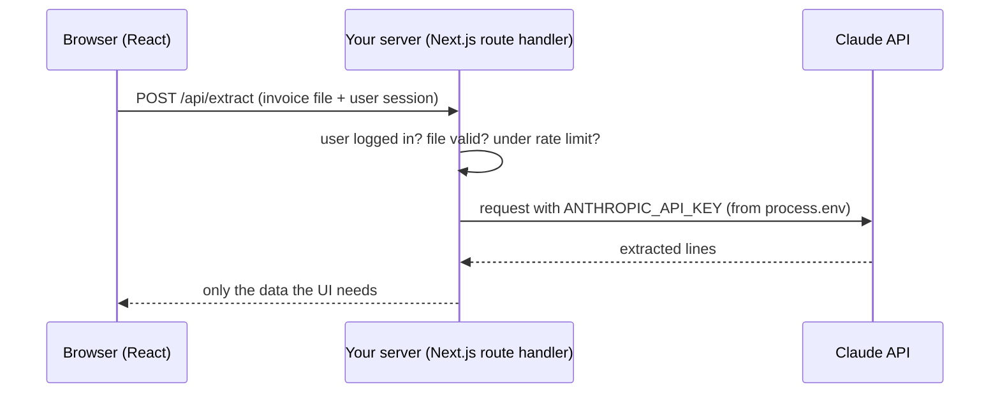

# Ce ajunge în browser

Regula de bază, pe care o repeți până devine reflex: **tot ce trimiți în browser e public.** Codul JavaScript, variabilele „ascunse”, răspunsurile de la API, header-ele cererilor. Oricine deschide DevTools le vede. Fișierul ăsta îți arată de ce, iar demonstrația ți-o face concret.

## Bundle-ul e public

**Ce e.** Când cineva îți deschide aplicația React, browserul descarcă fișierele JavaScript ale aplicației (bundle-ul) și le rulează **pe calculatorul vizitatorului**. Ce e acolo, vizitatorul poate citi.

```
        SERVER (yours)                    BROWSER (theirs)
  ┌──────────────────────┐          ┌───────────────────────────┐
  │ Nest / Next server   │          │ index-a1b2c3.js           │
  │ process.env.SECRET ✓ │  HTTP    │  ← downloaded, readable,  │
  │ database password ✓  │ ───────▶ │    editable by anyone     │
  └──────────────────────┘          │ VITE_* / NEXT_PUBLIC_* ✗  │
     secrets live here              └───────────────────────────┘
                                       nothing secret here
```

**De ce contează.** Minificarea (codul comprimat, cu nume scurte) nu e criptare. Un „repo privat” nu ajută cu nimic: ce ajunge în bundle e public, indiferent cât de privat e codul sursă.

**Capcana.** „Am pus cheia într-o variabilă cu nume ciudat, n-o găsește nimeni.” Un `Ctrl+F` în DevTools o găsește în 10 secunde.

## VITE_ și NEXT_PUBLIC_ înseamnă „publică asta”

**Ce e.** Vite și Next.js pun în bundle **doar** variabilele cu prefixul `VITE_` sau `NEXT_PUBLIC_`. Prefixul e o decizie explicită: îi spui uneltei „vreau ca valoarea asta să ajungă în browser”. Documentația Vite o spune direct: variabilele `VITE_*` nu trebuie să conțină informații sensibile, cum sunt cheile API.

**Exemplu minim: GREȘIT**

```ts
// WRONG: this key is now in every visitor's browser
import Anthropic from '@anthropic-ai/sdk';

const anthropic = new Anthropic({
  apiKey: import.meta.env.VITE_ANTHROPIC_API_KEY,
  dangerouslyAllowBrowser: true, // the SDK makes you type "dangerously" for a reason
});
```

**Ce poate sta în frontend:** URL-ul API-ului tău, URL-ul proiectului Supabase, cheia *publishable* Supabase, un ID de analytics. Tot ce a fost **proiectat** să fie public.

**Capcana.** AI-ul, când îi ceri să „facă să meargă repede”, pune uneori cheia în frontend cu `dangerouslyAllowBrowser: true` sau cu prefixul `VITE_`. La review cauți exact prefixele astea ([12-lucrul-cu-ai/02-review-la-cod-generat.md](../12-lucrul-cu-ai/02-review-la-cod-generat.md)).

## Demonstrația: găsești o cheie în DevTools

Fă exercițiul ăsta o dată, în P1. Nu-l mai uiți.

1. În proiectul P1, în `.env`, adaugă:

   ```bash
   VITE_DEMO_KEY=not-a-secret-123
   ```

2. Folosește-o undeva în cod, de exemplu `console.log(import.meta.env.VITE_DEMO_KEY)` în `main.tsx`.
3. Fă build-ul de producție și pornește-l, din terminalul WSL:

   ```bash
   npm run build
   npm run preview
   ```

4. Caut-o direct în fișierele generate:

   ```bash
   grep -r "not-a-secret-123" dist/
   # dist/assets/index-xxxxxxxx.js: ... "not-a-secret-123" ...
   ```

5. Deschide adresa afișată de `preview` (de obicei `http://localhost:4173`) în browserul din **Windows**. WSL trimite automat `localhost` spre browser.
6. Apasă `F12` → tab-ul **Sources** (Chrome/Edge). Deschide fișierul din `assets/`, apasă `Ctrl+F` și caută `not-a-secret`. E acolo, în clar.
7. Bonus: tab-ul **Network** → orice cerere → **Headers**. Vezi tot ce trimite aplicația, inclusiv header-ele `Authorization` sau `apikey`.

**Ce s-a întâmplat de fapt.** La build, Vite a înlocuit `import.meta.env.VITE_DEMO_KEY` cu textul `"not-a-secret-123"`, direct în fișierul JavaScript. Acel fișier e servit oricui deschide pagina.

Șterge variabila după demonstrație.

## Chei publishable vs secret (Supabase și nu numai)

**Ce e.** Multe servicii îți dau două tipuri de chei. Pe Supabase:

| | Publishable (`sb_publishable_...`) | Secret (`sb_secret_...`) |
|---|---|---|
| Unde | browser, aplicații mobile, oriunde | **doar** backend: Nest, route handlers Next.js |
| Ce poate | ce îi permit politicile RLS | **ocolește RLS**, acces total |
| Dacă scapă | nicio problemă, e făcută să fie publică | rotești imediat |

Cheile vechi, `anon` și `service_role`, sunt echivalentele lor *legacy*. Le mai vezi în tutoriale, iar Supabase le scoate treptat din uz. Detalii în [08-baze-de-date-supabase/04-conectare-si-chei.md](../08-baze-de-date-supabase/04-conectare-si-chei.md).

Același tipar îl găsești la Stripe (`pk_...` publică, `sk_...` secretă) și la multe alte servicii.

**Capcana.** Supabase refuză cheile secret când cererea vine dintr-un browser: verifică header-ul `User-Agent` și răspunde cu 401. Asta te protejează doar de o greșeală, nu și de un atacator. Cu `curl`, o cheie secret scăpată funcționează perfect.

<details>
<summary>Întrebare de interviu: Cum folosești cheia API a unui serviciu terț într-o aplicație React?</summary>

Nu o pun în React, pentru că tot ce e în bundle e public, inclusiv variabilele `VITE_` sau `NEXT_PUBLIC_`. Cheia stă pe server, ca variabilă de mediu. Frontend-ul îmi cheamă propriul endpoint de backend, care verifică utilizatorul, validează input-ul, face cererea către serviciul terț cu cheia și întoarce doar ce trebuie. Excepție fac cheile proiectate să fie publice, cum e cheia publishable Supabase, protejată de RLS.
</details>

## Soluția: backend-ul ca intermediar

**Ce e.** Când frontend-ul are nevoie de un serviciu care cere o cheie secretă, cererea trece prin backend-ul tău. Backend-ul ține cheia și decide ce are voie să ceară fiecare utilizator.



**Cum îl vezi în cod real** (P4, Next.js)

```ts
// app/api/extract/route.ts — runs only on the server
import Anthropic from '@anthropic-ai/sdk';

const anthropic = new Anthropic(); // reads ANTHROPIC_API_KEY from process.env

export async function POST(request: Request) {
  // 1. check the user is logged in, otherwise anyone can spend your credits
  // 2. validate the uploaded file (type, size)
  // 3. call Claude, return only what the client needs
}
```

- Cheia nu apare nicăieri în codul de client.
- Endpoint-ul verifică utilizatorul. Altfel ai creat un „Claude gratuit” pentru oricine îți găsește URL-ul, plătit din contul tău.
- În Next.js, pachetul `server-only` (`import 'server-only'` în fișierele cu secrete) face build-ul să pice dacă un astfel de fișier ajunge, din greșeală, importat într-o componentă de client.

**Capcana.** Să crezi că CORS îți protejează endpoint-ul. CORS e o regulă aplicată **de browser**, ca site-urile străine să nu-ți poată citi răspunsurile în numele utilizatorului. `curl` sau un script ignoră CORS complet. Protecția reală e autentificarea și rate limiting-ul ([02-cum-functioneaza-webul/05-auth-cookies-cors.md](../02-cum-functioneaza-webul/05-auth-cookies-cors.md)).

## Mai departe

- [Env Variables and Modes](https://vite.dev/guide/env-and-mode): avertismentul de securitate din Vite
- [Understanding API keys](https://supabase.com/docs/guides/api/api-keys): Supabase
- [Chrome DevTools: Network panel](https://developer.chrome.com/docs/devtools/network)
