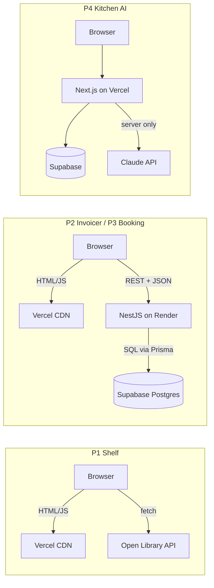

# Ce înseamnă deploy

Înainte de butoane și comenzi: ce se întâmplă de fapt când codul de pe laptopul tău ajunge pe internet, și de ce fiecare proiect al tău stă în alt loc.

## Build vs. run

**Ce e.** **Build** înseamnă transformarea codului sursă într-un artefact gata de rulat: TypeScript compilat în JavaScript, fișiere unite și minimizate. **Run** înseamnă procesul care servește efectiv request-uri. Unele aplicații au nevoie doar de build, altele și de un proces care rulează continuu.

**De ce contează.** Diferența decide unde poate sta aplicația și cât costă. Un frontend Vite, după build, e doar un folder cu fișiere statice (`dist/`), care poate fi servit de oriunde. Un API Nest trebuie să ruleze ca proces Node, ca să răspundă la request-uri.

**Exemplu minim**

```bash
# Frontend (Vite): build only — the result is static files
npm run build          # → dist/index.html, dist/assets/index-a1b2c3.js, ...

# Backend (Nest): build, then run a process that stays alive
npm run build          # tsc → dist/main.js
npm run start:prod     # node dist/main → listens for requests on a port
```

**Cum îl vezi în cod real.** În `package.json` ai scripturile `build`, `start` și uneori `start:prod`. Platformele de hosting îți cer exact două comenzi: *Build Command* și *Start Command*. Un site static nu are Start Command.

**Capcana.** Să faci deploy cu `npm run dev`. Serverul de dev e lent, nu e optimizat și expune unelte de debugging. În producție rulează mereu build-ul.

<details>
<summary>Întrebare de interviu: Ce se întâmplă la `npm run build` într-un proiect Vite?</summary>

Vite compilează TypeScript-ul și JSX-ul în JavaScript, unește modulele în câteva fișiere (bundling), le minimizează, elimină codul nefolosit și pune hash-uri în numele fișierelor pentru cache. Înlocuiește și variabilele `import.meta.env.VITE_*` cu valorile lor. Rezultatul, în `dist/`, e un set de fișiere statice care pot fi servite de orice server sau CDN.
</details>

## Medii: local, preview, production

**Ce e.** Aceeași aplicație rulează în mai multe *medii*, fiecare cu propriile valori de configurare:

- **local**, pe laptopul tău, cu `.env`;
- **preview**, câte o versiune pentru fiecare PR, ca să vezi schimbarea înainte de merge;
- **production**, versiunea publică, construită din branch-ul `main`.

**De ce contează.** Codul e același, configurarea diferă: URL-ul API-ului, cheile, baza de date. Dacă amesteci mediile, ajungi să scrii date de test în producție sau să pui chei de producție pe laptop.

**Exemplu minim**

```
                 local                  preview (per PR)           production (main)
VITE_API_URL     http://localhost:3000  https://api.onrender.com   https://api.onrender.com
Database         Supabase (dev data)    same as prod or a dev DB   Supabase (real data)
Who sees it      only you               you + reviewer (link)      everyone
```

**Cum îl vezi în cod real.** Codul citește configurarea din variabile de mediu, niciodată din valori scrise direct în cod. Valorile pentru fiecare mediu se setează în dashboard-ul platformei (Vercel, Render), nu în repo. Pe laptop, în `.env`, care e în `.gitignore` (vezi [01-env-vars](../10-securitate-env/01-env-vars.md)).

**Capcana.** Un URL de `localhost` sau o cheie scrisă direct în cod „doar pentru test”, care ajunge apoi în producție. Dacă o valoare diferă între medii, e variabilă de mediu, fără excepție.

<details>
<summary>Întrebare de interviu: Ce sunt mediile de deploy și de ce le separi?</summary>

Sunt instanțe ale aceleiași aplicații cu configurări diferite: local pentru dezvoltare, preview sau staging pentru verificare înainte de lansare, production pentru utilizatori. Le separ ca să pot testa schimbări fără să afectez utilizatorii și datele reale. Codul e identic, diferă doar variabilele de mediu, iar promovarea se face prin Git: un PR primește preview, iar merge-ul în `main` ajunge în producție.
</details>

## Tipuri de hosting

**Ce e.** Patru moduri în care poate rula o parte din aplicație:

| Tip | Ce rulează | Exemplu la tine |
|---|---|---|
| **Static / CDN** | fișiere gata făcute, copiate pe servere din toată lumea | frontend-ul Vite din P1–P3, pe Vercel |
| **Serverless** | funcții pornite la fiecare request, oprite după | partea de server din Next.js (P4), pe Vercel |
| **Server care rulează continuu** | un proces care stă pornit și ascultă pe un port | API-ul Nest din P2–P3, pe Render |
| **Bază de date administrată** | Postgres întreținut de altcineva (backup, update-uri) | Supabase |

**De ce contează.** E o întrebare frecventă de interviu („unde ai pune asta și de ce?”) și explică de ce proiectele tale stau în trei locuri diferite.

**Exemplu minim**

```
Static / CDN:   request → nearest CDN node → file already exists → instant
Serverless:     request → function starts (if cold) → runs → returns → stops
Long-running:   request → process already listening → handles it → keeps running
```

**Cum îl vezi în cod real.** Un API Nest ține conexiuni deschise la baza de date și state în memorie (de exemplu un cache), așa că se potrivește cu un proces care rulează continuu. Funcțiile serverless nu păstrează nimic între request-uri, deci codul pentru ele trebuie scris fără state în memorie.

**Capcana.** Să salvezi fișiere pe disc pe un server de hosting (de exemplu uploads în `./uploads`). Pe Render free, discul se golește la fiecare restart sau redeploy. Fișierele încărcate de utilizatori merg în storage dedicat: Supabase Storage.

<details>
<summary>Întrebare de interviu: Care e diferența între serverless și un server clasic?</summary>

Un server clasic e un proces care rulează continuu: păstrează conexiuni și state în memorie, iar costul e fix chiar și fără trafic. Serverless înseamnă funcții pornite la cerere: scalează automat și costă doar cât rulează, dar pot avea cold start, au limită de durată și nu păstrează state între invocări. Aleg în funcție de trafic, durata operațiilor și nevoia de conexiuni persistente.
</details>

## Unde stă fiecare proiect

**Ce e.** Harta concretă a proiectelor tale, toate pe planuri gratuite.

**De ce contează.** Când explici un proiect la interviu, desenezi exact diagrama asta. E prima întrebare de „system design” pe care o primește un junior.

**Exemplu minim**



**Cum îl vezi în cod real.** În P2 și P3 frontend-ul și API-ul sunt două proiecte deployate separat, care se găsesc prin variabile de mediu: frontend-ul știe URL-ul API-ului (`VITE_API_URL`), iar API-ul știe originea frontend-ului (`CORS_ORIGIN`). În P4, Next.js le ține pe amândouă în același deploy.

**De ce Render, și nu tot Vercel?** Vercel poate rula și o aplicație Nest, transformată într-o funcție serverless. Render îți arată însă modelul clasic, un proces care pornește o dată și ascultă pe un port. Pe ăsta îl vei întâlni în cele mai multe companii (containere, VM-uri, Kubernetes), așa că merită să-l vezi o dată pe viu.

**Capcana.** Să crezi că frontend-ul și API-ul „se găsesc singure” după deploy. Sunt două aplicații pe două domenii diferite. Fără `VITE_API_URL` setat în Vercel și fără `CORS_ORIGIN` setat în Render, frontend-ul fie bate la `localhost`, fie e blocat de browser.

<details>
<summary>Întrebare de interviu: Descrie arhitectura de deploy a unui proiect full-stack pe care l-ai făcut.</summary>

Răspund cu P2: frontend-ul React, compilat cu Vite, stă pe Vercel ca fișiere statice servite de CDN. API-ul NestJS rulează pe Render ca serviciu web și se conectează la Postgres pe Supabase prin Prisma. Frontend-ul cunoaște URL-ul API-ului printr-o variabilă de mediu de build, iar API-ul acceptă doar originea frontend-ului prin CORS. Fiecare push pe `main` declanșează deploy automat pe ambele platforme.
</details>

## Deploy continuu din GitHub

**Ce e.** Vercel și Render se leagă de repo-ul tău GitHub. La fiecare push pe `main` fac build și deploy automat. La fiecare PR, Vercel creează și un deploy de *preview* cu link propriu.

**De ce contează.** Git devine singura sursă de adevăr: ce e pe `main` e în producție. Nu mai urci fișiere de mână și nu modifici nimic direct pe server. Așa lucrează orice echipă.

**Exemplu minim**

```
git push origin feature/invoice-pdf
  → PR opened → Vercel: preview deployment → link posted on the PR
  → review + CI green → merge into main
  → Vercel + Render: production deployment (automatic)
```

**Cum îl vezi în cod real.** Pe pagina PR-ului din GitHub apar comentarii și status checks de la Vercel, cu link spre preview. Reviewer-ul (Bogdan) poate vedea schimbarea live înainte să o aprobe.

**Capcana.** Să repari o problemă „rapid” direct în dashboard-ul platformei, de exemplu schimbând un fișier sau o comandă fără să o pui și în repo. La următorul deploy, reparația dispare. Orice schimbare trece prin Git.

<details>
<summary>Întrebare de interviu: Ce e un preview deployment și la ce folosește?</summary>

E o versiune live, cu URL propriu, a aplicației construită din codul unui PR, separată de producție. Reviewer-ii și designerii pot vedea și testa schimbarea înainte de merge. Bug-urile vizuale și de integrare se prind înainte să ajungă la utilizatori, iar discuția din PR se bazează pe ceva concret, nu doar pe diff.
</details>

## „Merge pe laptop” — de ce nu merge în producție

**Ce e.** Lista diferențelor obișnuite dintre laptopul tău și serverul de producție. Aproape toate erorile de la primul deploy vin de aici.

**De ce contează.** Când un deploy pică, verifici lista în ordine în loc să ghicești. E și o întrebare bună de interviu despre experiența practică.

**Exemplu minim**

```
□ env var missing or different in production (most common)
□ different Node version (pin it: .nvmrc / engines)
□ prod database is empty or migrations weren't run
□ API URL still points to localhost
□ CORS origin doesn't match the deployed frontend URL
□ dependency installed globally on your laptop, missing from package.json
□ file name case: import "./BookCard" but the file is "bookCard.tsx"
```

**Cum îl vezi în cod real.** La ultimul punct, WSL te ajută: sistemul de fișiere Linux face diferența între litere mari și mici, la fel ca serverele, deci eroarea apare deja local. Pe partea de Windows (`/mnt/c`) n-ai vedea-o. Încă un motiv să lucrezi în `~/code`.

**Capcana.** Să schimbi lucruri la întâmplare și să faci deploy de zece ori. Citește întâi logul de build sau de runtime (vezi [04-loguri-si-productie](04-loguri-si-productie.md)), identifică punctul din listă, apoi repari o dată.

<details>
<summary>Întrebare de interviu: Aplicația merge local, dar nu în producție. Cum procedezi?</summary>

Citesc logurile, cele de build și cele de runtime, ca să văd exact eroarea. Apoi verific diferențele tipice: variabile de mediu lipsă sau greșite, versiunea de Node, migrațiile neaplicate pe baza de producție, URL-uri spre localhost, CORS. Reproduc problema cât mai local, cu aceeași configurare, repar printr-un commit și verific din nou în producție. Nu modific nimic direct pe server.
</details>

## Mai departe

- [Vercel: Deployments overview](https://vercel.com/docs/deployments)
- [Render: Web Services](https://render.com/docs/web-services)
- [Vite: Building for Production](https://vite.dev/guide/build.html)
