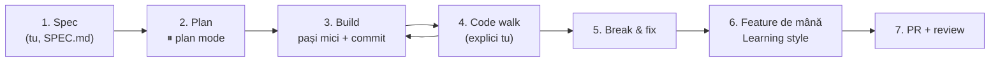

# Workflow-ul cu Claude Code

Bucla în 7 pași din [metodă](../00-start/01-metoda.md), aplicată concret: ce scrii la fiecare pas, în ce mod e Claude Code și cum îți păstrezi controlul. Exemplul care trece prin tot fișierul e un feature din P2 Invoicer: marcarea unei facturi ca plătită.

## Bucla, pe scurt



Regula care ține bucla în viață: **un feature = un branch = o sesiune curată = un PR.**

## Pasul 1 — Spec-ul îl scrii tu

**Ce e.** Un document scurt (`SPEC.md` sau secțiunea „What it does” din README) cu ce construiești, nu cum.

**De ce contează.** Dacă nu știi ce vrei, Claude decide în locul tău și proiectul nu mai e al tău. Spec-ul e și ținta față de care verifici la final.

**Exemplu minim**

```markdown
## Feature: record a payment

- On the invoice detail page, a "Record payment" form (only for invoices with status `SENT`, overdue ones included).
- Fields: amount and payment date (default: today). The date can't be in the future; the amount must be > 0 and not more than what's left to pay.
- When payments cover the total, the status becomes `PAID`. The dashboard "unpaid total" updates.
- Out of scope: refunds, payments in another currency.
- Done when: works end to end, the API rejects a future date and an overpayment, there is a test for each.
```

**Capcana.** Spec de o linie („fă plata facturilor”). Cele mai bune spec-uri spun și ce **nu** intră și cum arată „gata”.

Pentru un proiect întreg, pornește cu promptul de interviu din [kit](04-kit-de-prompturi.md#planificare): Claude îți pune întrebări despre cazurile la care nu te-ai gândit și tu decizi.

## Pasul 2 — Plan mode

**Ce e.** Claude citește codul și propune un plan, fără să editeze nimic. Intri cu `Shift+Tab` până vezi `⏸ plan mode on`, sau direct cu `/plan`.

**Exemplu minim**

```text
/plan Implementează feature-ul din @SPEC.md, secțiunea "mark invoice as paid".
Spune-mi ce fișiere atingi, cum arată endpoint-ul și ce validări pui.
Pentru fiecare decizie, dă-mi o alternativă și de ce n-ai ales-o.
```

**Cum citești planul.** Întrebi „de ce?” la fiecare decizie pe care n-ai fi luat-o tu. De exemplu: „De ce `PATCH /invoices/:id/pay` și nu `PATCH /invoices/:id` cu `status: 'paid'`?” Răspunsul e o mini-lecție de API design. Poți edita planul direct cu `Ctrl+G`.

**Aprobarea.** În primele proiecte alegi **„Yes, manually approve edits”**, nu varianta cu auto mode. Vrei să vezi fiecare pas.

**Capcana.** Să aprobi un plan pe care nu l-ai înțeles „ca să meargă mai repede”. Tot timpul pe care îl câștigi acum îl pierzi la code walk.

## Pasul 3 — Build pe pași mici

**Ce e.** Implementezi planul felie cu felie. După fiecare felie: rulezi, te uiți la diff, faci commit.

```bash
git switch -c feat/mark-invoice-paid
```

```text
Fă doar pasul 1 din plan: endpoint-ul și DTO-ul, cu validarea datei.
Scrie un test pentru data din viitor și rulează testele. Arată-mi output-ul.
```

**De ce contează.** Pașii mici fac fiecare diff ușor de citit, iar fiecare commit e un punct de salvare la care te poți întoarce. Când îi dai lui Claude o verificare pe care o poate rula singur (un test, build-ul, `npm run lint`), se corectează singur în loc să te folosească pe tine ca tester.

**Ritmul unei felii**

1. Prompt pentru un singur pas, cu verificarea inclusă.
2. Claude lucrează. Tu citești comenzile pe care le aprobi.
3. Diff-ul în VS Code (Source Control) sau cu `git diff`, după [checklist](02-review-la-cod-generat.md).
4. Rulezi aplicația și te uiți cu ochii tăi.
5. `git commit` cu un mesaj clar (`feat: add pay endpoint with date validation`).

**Capcana.** „Fă tot planul.” Primești un diff de 600 de linii pe care nu-l mai citește nimeni, nici tu, nici Bogdan la review.

## Pasul 4 — Code walk

**Ce e.** La finalul feature-ului explici **tu** fiecare fișier modificat. Claude ascultă, corectează și întreabă.

```text
Vreau să-ți explic ce face feature-ul "mark as paid", fișier cu fișier, pornind de la
butonul din frontend până la UPDATE-ul în baza de date. Nu mă întrerupe.
După ce termin, corectează-mă unde am greșit și pune-mi 3 întrebări grele.
```

Ce ai înțeles scrii în `ARCHITECTURE.md` (modelul e în [templates/ARCHITECTURE.md](../templates/ARCHITECTURE.md)): fluxul unui request, de ce ai ales soluția, ce ai învățat.

**Capcana.** Să-i ceri lui Claude „explică-mi codul” și să dai din cap. Înțelegerea se verifică doar când explici tu.

## Pasul 5 — Break & fix

**Ce e.** Într-o **sesiune nouă** (`/clear`, ca să nu știe ce s-a discutat), îi ceri să strice ceva subtil fără să-ți spună ce și unde. Tu găsești problema.

```text
Introdu un singur bug subtil în feature-ul "mark as paid" (frontend sau backend),
fără să-mi spui unde. Nu lăsa comentarii. Fă commit pe un branch nou numit drill/1.
Când îți spun "indiciu", dă-mi câte unul, de la vag la precis.
```

Cauți cu ce ai: mesajul de eroare, Network tab-ul din DevTools, logurile serverului, debugger-ul din VS Code.

**De ce contează.** Debugging-ul e skill-ul care se vede cel mai clar la interviu și la primul job. Și e singurul pe care un AI nu-l poate exersa în locul tău.

## Pasul 6 — Feature-ul de mână

**Ce e.** O bucată mică pe care o scrii tu. Fiecare brief de proiect propune una. Două variante:

- **Fără AI deloc**: scrii codul, apoi ceri review (prompt-ul „review ca un senior” din [kit](04-kit-de-prompturi.md#review)).
- **Cu Learning style**: `/output-style learning`. Claude construiește partea de rutină și îți lasă `TODO(human)` exact la deciziile interesante.

Scrie-l în `CLAUDE.md` la „Built by hand”, ca să nu-l scrie Claude din inerție.

## Pasul 7 — PR și review

```text
Scrie descrierea de PR pentru branch-ul ăsta: ce s-a schimbat, de ce, cum se testează.
Folosește template-ul din .github/pull_request_template.md.
```

```bash
git push -u origin feat/mark-invoice-paid
gh pr create --fill --reviewer itsbogdann
```

Citește descrierea înainte s-o trimiți. Dacă scrie ceva ce n-ai face sau n-ai spune, o rescrii. Ce urmează (review, comentarii, merge) e în [09-git-github-echipa/03-pull-requests.md](../09-git-github-echipa/03-pull-requests.md).

## Contextul: resursa pe care o gestionezi

**Ce e.** Contextul e tot ce „vede” Claude în sesiunea curentă: mesajele tale, fișierele citite, output-ul comenzilor. Are o limită, iar calitatea răspunsurilor scade pe măsură ce se umple.

**De ce contează.** Pe Pro, fiecare mesaj trimite din nou tot contextul. Un context murdar înseamnă răspunsuri mai proaste **și** limite consumate mai repede.

**Reguli practice**

- `/clear` între feature-uri. Sesiunea „chiuvetă”, în care sari de la un task la altul și înapoi, e cea mai scumpă și cea mai proastă.
- **L-ai corectat de două ori pe aceeași problemă? `/clear`** și un prompt nou, mai precis, care include ce ai aflat. O sesiune curată cu un prompt bun bate aproape mereu una lungă cu corecturi adunate.
- `/context` îți arată ce ocupă loc.
- Pentru o întrebare pe lângă („ce înseamnă `Partial<T>`?”) folosește `/btw`. Răspunsul nu intră în conversație.
- Detalii în [03-claude-md-si-context.md](03-claude-md-si-context.md).

<details>
<summary>Întrebare de interviu: Cum te asiguri că un cod generat de AI e corect?</summary>

Îl tratez ca pe codul unui coleg nou: nu e corect până nu e verificat. Înainte să scriu cod, cer un plan și îl discut. Lucrez pe pași mici, ca fiecare diff să poată fi citit. Îi dau agentului o verificare pe care o poate rula singur, de exemplu teste, typecheck sau lint. Citesc fiecare diff după un checklist: cazuri limită, erori tratate, securitate, dependențe noi. Apoi rulez aplicația și verific comportamentul cu ochii mei. Ce nu pot explica nu intră în commit.
</details>

## Mai departe

- [Best practices — Claude Code docs](https://code.claude.com/docs/en/best-practices)
- [Common workflows — Claude Code docs](https://code.claude.com/docs/en/common-workflows)
