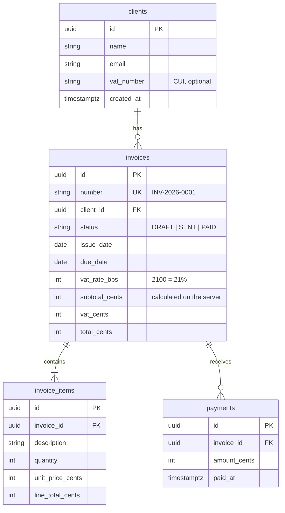

# P2 · Invoicer

> Facturare pentru freelanceri: clienți, facturi, încasări.

**Când:** săptămânile 3–4 (~40 h) · **Tip:** full-stack, cu frontend, API și bază de date separate · **Domeniu:** B2B / fintech

## Ce face

Un freelancer își ține clienții, emite facturi cu mai multe linii, le marchează ca trimise sau încasate și vede pe un dashboard cât are de încasat și ce e întârziat.

Ai nevoie de el oricum, când o să lucrezi pe SRL. Și e exact tipul de aplicație pe care îl construiesc firmele care încă angajează juniori: enterprise, fintech, agenții.

## Ce înveți pe el

- **Granița frontend/backend, pe bune:** două aplicații, două deploy-uri, un API între ele.
- **NestJS:** module, controllers, services, DTO-uri, validare, erori, Swagger.
- **Postgres pe Supabase cu Prisma:** relații 1-n, migrații, tranzacții.
- **Reguli de business pe server:** totaluri, statusuri, numerotare unică.
- **Variabile de mediu pe ambele părți**, și de ce secretele stau doar pe backend.
- **CORS și deploy:** Render pentru API, Vercel pentru frontend.

**Capitole:** [02](../02-cum-functioneaza-webul/) (recapitulare), [07](../07-backend-node-nest/) (01–05), [08](../08-baze-de-date-supabase/) (01–05), [10](../10-securitate-env/), [11](../11-deploy/) (03–04).

## Arhitectura

```
┌──────────────────┐   HTTP + JSON   ┌──────────────────┐   Prisma   ┌──────────────────┐
│  React (Vite)    │ ──────────────> │  NestJS API      │ ─────────> │  Postgres        │
│  pe Vercel       │ <────────────── │  pe Render       │ <───────── │  pe Supabase     │
└──────────────────┘                 └──────────────────┘            └──────────────────┘
   VITE_API_URL                         DATABASE_URL (secret)
   (public)                             CORS_ORIGIN
```

**Un singur repo `invoicer` cu două foldere,** `web/` (Vite) și `api/` (Nest), fără unelte de monorepo. Vercel și Render știu amândouă să facă deploy dintr-un subfolder.

**Un proiect Supabase, folosit de două aplicații.** Planul gratuit Supabase permite doar 2 proiecte active, iar tu ai nevoie de trei baze de date live. Soluția:

- **Un proiect comun pentru P2 și P3**, de exemplu `portfolio-db`, în care fiecare aplicație are propria **schemă Postgres**: `invoicer` pentru P2, `booking` pentru P3.
- **Un proiect separat pentru P4.**

Tabelele din P2 stau deci în schema `invoicer`, nu în `public`. Detalii în [08-baze-de-date-supabase/03-cont-supabase.md](../08-baze-de-date-supabase/03-cont-supabase.md).

## Modelul de date



E același model pe care îl construiește pas cu pas [07-backend-node-nest/05-baza-de-date-cu-prisma.md](../07-backend-node-nest/05-baza-de-date-cu-prisma.md).

Trei lucruri de observat:

- **Banii sunt întregi** (bani/cenți), niciodată float. De ce, vezi în [04-javascript/06-js-in-cod-real.md](../04-javascript/06-js-in-cod-real.md).
- **Cota de TVA e un câmp pe factură, nu o constantă în cod.** Cota standard din România s-a schimbat în 2025, iar o factură veche trebuie să rămână cu cota ei.
- **„Overdue” nu e un status stocat.** Se calculează: `status = SENT` și `due_date` a trecut. Ce poate fi calculat nu se stochează, pentru că altfel ajunge să mintă.
- **Totalurile se salvează, dar le calculează doar serverul**, o singură dată, la creare. Factura emisă e un document: totalul ei nu trebuie să se schimbe dacă se schimbă ceva în cod.

## Funcționalități

**Obligatorii**

1. CRUD pentru clienți, cu validare (email valid, nume obligatoriu).
2. Creezi o factură: alegi clientul, adaugi linii (descriere, cantitate, preț), cota TVA, moneda și scadența.
3. **Totalurile (subtotal, TVA, total) se calculează pe server.** Frontend-ul doar le afișează.
4. Numerotare automată și unică (`INV-2026-0001`). Nu apar duplicate nici dacă două request-uri vin în același timp, și asta o garantează baza de date.
5. Factura și liniile ei se salvează într-o singură **tranzacție**: ori tot, ori nimic.
6. Statusuri: `DRAFT → SENT → PAID`. O factură trimisă nu se mai poate edita, iar regula stă pe server.
7. **Încasări:** înregistrezi o plată (sumă și dată); sunt permise și plățile parțiale.
   - Când suma încasărilor acoperă totalul, factura devine `PAID`, în aceeași tranzacție.
   - Serverul refuză o plată mai mare decât restul de plată.
8. Lista de facturi cu filtrare (status, client), sortare și paginare, toate făcute pe server.
9. Dashboard: de încasat, întârziate, încasat luna asta.
10. Documentația API-ului cu Swagger la `/docs`.
11. Seed cu date demo, ca oricine deschide aplicația să vadă ceva.

**Dacă ai timp**

- Export PDF al facturii.
- Facturi în EUR cu cursul BNR din ziua emiterii.
- *Duplicate invoice.*

**Fără autentificare în P2.** Vine în P3. În README scrii clar că e un demo fără conturi.

**Pe tabele activezi RLS fără politici.** Schema `invoicer` nu e expusă implicit prin API-ul Supabase, deci nimeni nu ajunge direct la date pe acolo, dar RLS-ul închide și ușa asta. Accesul rămâne doar prin backend-ul tău. Vezi [08-baze-de-date-supabase/06-rls-auth-storage.md](../08-baze-de-date-supabase/06-rls-auth-storage.md).

## Feature-ul de mână

**Calculul totalurilor:** o funcție pură `computeInvoiceTotals(items, vatRateBps)` care întoarce subtotal, TVA și total în bani, cu regula de rotunjire clară. Plus testele ei unitare, scrise tot de tine. E food cost-ul din ziua 3, dar pentru facturi și testat.

## Break & fix

După deploy, cere-i lui Claude un bug „de producție” pe un branch: o variabilă de mediu cu nume greșit, CORS configurat pentru alt domeniu, un `await` lipsă într-un service. Îl găsești din logurile de pe Render și din Network tab-ul din browser.

## Ordinea sugerată a PR-urilor

1. **Setup:** `web/` (Vite) + `api/` (`nest new`), README, `.env.example` în ambele.
2. **Baza de date:** proiect Supabase, schema Prisma, prima migrație, seed.
3. **API clienți:** modulul `clients`, DTO-uri, validare, Swagger.
4. **UI clienți:** listă, formular, TanStack Query cu mutații.
5. **API facturi:** creare cu linii în tranzacție, numerotare, totaluri.
6. **UI facturi:** formular cu linii dinamice.
7. **Reguli și încasări:** tranziții de status, overdue, blocarea editării, plăți (în tranzacție).
8. **Listă și dashboard:** filtre, paginare, sumarul.
9. **Deploy:** Render (api) și Vercel (web), CORS, env vars.
10. **Polish:** README cu diagrama, screenshot, Swagger public.

## Promptul de start (în plan mode)

```
Citește spec-ul din README.md și CLAUDE.md. Construim Invoicer: web/ (React + Vite) și api/ (NestJS + Prisma + Supabase Postgres).
Înainte de orice cod, propune:
- schema Prisma (cu relații, constrângeri și indecși) și explică fiecare alegere
- modulele Nest și endpoint-urile REST (metodă, rută, body, răspuns, coduri de status)
- unde se calculează totalurile și cum garantăm numerotarea unică
- ce variabile de mediu are fiecare aplicație și care sunt secrete
- ordinea PR-urilor
Nu scrie cod până nu aprob planul.
```

## Ce trebuie să poți explica la final (→ [CP3](../checkpoints/CP3.md))

- Drumul complet al lui *Save invoice*: componentă → `fetch` → controller → ValidationPipe → service → Prisma → Postgres, și înapoi.
- De ce totalul se calculează pe server.
- Ce e o tranzacție și unde ai folosit-o.
- Ce e o migrație și ce rulează la deploy.
- De ce `DATABASE_URL` nu are ce căuta în frontend și ce se întâmplă dacă ajunge acolo.
- Ce ai configurat la CORS și de ce.
