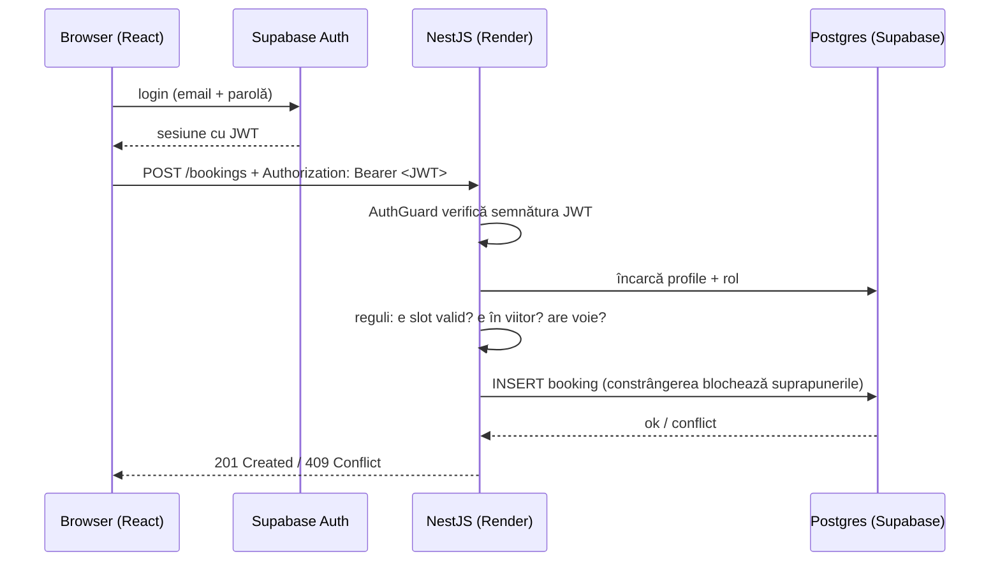

# P3 · Booking

> Rezervări de săli, terenuri sau studiouri, cu conturi și roluri.

**Când:** săptămânile 5–6 (~40 h) · **Tip:** SaaS multi-user · **Domeniu:** servicii / programări

Alegi tu tema concretă: săli de ședință într-un coworking, terenuri de tenis, un studio foto. Logica e aceeași.

## Ce face

Membrii își fac cont, văd ce sloturi sunt libere pentru o resursă într-o zi și rezervă sau anulează. Adminul gestionează resursele și programul lor și vede toate rezervările. Două persoane nu pot rezerva niciodată același slot, nici dacă apasă butonul în aceeași secundă.

## Ce înveți pe el

- **Autentificare** cu Supabase Auth, cu JWT-ul verificat în Nest prin guards și cu roluri.
- **Autorizare:** cine are voie să vadă și să modifice ce. Aici înveți IDOR, cel mai frecvent bug de securitate al juniorilor.
- **O regulă de business serioasă:** fără rezervări suprapuse, garantat de baza de date, nu doar de un `if`.
- **Date și timezone-uri.**
- **Teste:** unit și e2e.
- **Lucru ca într-o echipă:** issues, branch-uri, PR-uri, CI, `main` protejat, review.

**Capitole:** [07](../07-backend-node-nest/) (06–07), [08](../08-baze-de-date-supabase/) (06), [09](../09-git-github-echipa/) (02–06), [10/05](../10-securitate-env/05-autentificare-vs-autorizare.md).

## Arhitectura

La fel ca P2 (`web/` + `api/` în același repo), plus Supabase Auth.

**Folosești același proiect Supabase ca în P2** (`portfolio-db`), cu schema ta, `booking`, și cu Auth activ în proiectul ăla. Motivul e limita de 2 proiecte gratuite, explicată în [P2](P2-invoicer.md#arhitectura).



## Modelul de date

- **`profiles`:** `id` (= id-ul userului din Supabase Auth), `full_name`, `role` (`admin` | `member`).
- **`resources`:** `id`, `name`, `description`, `capacity`, `open_time`, `close_time`, `slot_minutes`, `active`.
- **`bookings`:** `id`, `resource_id`, `user_id`, `starts_at` (timestamptz), `ends_at` (timestamptz), `status` (`confirmed` | `cancelled`), `created_at`.

**Cum blochezi suprapunerile:**

1. **Varianta de început:** sloturi fixe (de exemplu, de câte o oră) și un **unique index parțial** pe `(resource_id, starts_at)` doar pentru rezervările `confirmed`.
2. **Varianta de senior (opțional):** intervale libere, cu un **exclusion constraint** Postgres pe `tstzrange(starts_at, ends_at)`. Prisma nu poate exprima asta în schemă, deci o scrii ca SQL în migrație. Lecția: nu tot încape într-un ORM.

## Funcționalități

**Obligatorii**

1. Sign up, login și logout (email + parolă) cu Supabase Auth. Rutele din frontend sunt protejate.
2. Roluri: `member` rezervă pentru el, `admin` gestionează resursele și vede tot.
3. Admin: CRUD pentru resurse, cu program (de la ce oră la ce oră, durata unui slot).
4. Member: alege resursa și ziua, vede sloturile libere și ocupate, rezervă, anulează. Anulează doar rezervările lui și doar pe cele din viitor.
5. **Nicio rezervare suprapusă**, garantat de baza de date și testat cu request-uri simultane.
6. *My bookings*: rezervările viitoare și cele trecute.
7. **Timezone corect:** stochezi în UTC (`timestamptz`) și afișezi în `Europe/Bucharest`.
8. **Teste:**
   - unit pe regulile de rezervare;
   - e2e pe `POST /bookings`: succes → 201, suprapunere → 409, neautentificat → 401, rezervarea altuia → 403/404.
9. **GitHub Actions:** lint, typecheck și teste pe fiecare PR. `main` e protejat, deci merge-ul se face doar prin PR cu CI verde.

**Dacă ai timp**

- Sloturile se actualizează live când rezervă altcineva (Supabase Realtime).
- Limită: maximum 2 rezervări active per membru.
- Vizualizare săptămânală tip calendar.

## Fluxul de echipă (obligatoriu în P3)

Lucrezi ca și cum ai fi într-o echipă de cinci:

- **Issue-uri:** fiecare feature începe ca issue pe GitHub, cu criterii de acceptanță.
- **Branch-uri:** câte un branch per issue, de exemplu `feat/12-cancel-booking`.
- **PR-uri:** mici, cu descrierea după template, legate de issue (`Closes #12`).
- **Review:** CI-ul trebuie să treacă. Bogdan face review la cel puțin 3 PR-uri. Răspunzi la comentarii cu commit-uri noi, nu cu force push peste review.
- **Merge:** squash merge, apoi branch-ul se șterge.
- **Un conflict de merge rezolvat de tine.** Îl provoci intenționat, cu două branch-uri care modifică același fișier.

Detalii în [09-git-github-echipa](../09-git-github-echipa/).

## Feature-ul de mână

**Generarea sloturilor libere pentru o zi.** Având programul resursei și rezervările existente, întorci lista de sloturi cu starea fiecăruia. E logică pură, cu cazuri limită interesante (ora de închidere, sloturile din trecut, ziua în care se schimbă ora de vară/iarnă). Scrii funcția și testele ei.

## Break & fix

Cere-i lui Claude să scoată, pe un branch, verificarea de ownership dintr-un endpoint, fără să-ți spună care. Testele tale e2e ar trebui să prindă problema. Dacă nu o prind, ai găsit două bug-uri: cel din cod și cel din teste.

## Promptul de start (în plan mode)

```
Citește spec-ul din README.md și CLAUDE.md. Construim Booking: web/ (React) + api/ (NestJS + Prisma) + Supabase (Postgres și Auth).
Propune un plan care acoperă:
- cum verifică Nest JWT-ul Supabase (metoda recomandată acum în documentația Supabase) și cum ajungem la rolul userului
- guard-urile și decoratorii, și ce endpoint e protejat de ce
- schema și cum blocăm suprapunerile la nivel de bază de date
- ce testăm unit și ce testăm e2e
- workflow-ul de GitHub Actions
- lista de issue-uri, în ordine
Explică riscurile de securitate pe care le vezi.
```

## Ce trebuie să poți explica la final (→ [CP4](../checkpoints/CP4.md))

- Drumul login-ului: Supabase Auth → JWT → header → guard → user și rol.
- Authentication vs authorization, pe exemple din codul tău.
- De ce un `if (slotIsFree)` în service nu ajunge și ce face constrângerea din baza de date.
- Ce rulează CI-ul, când, și ce se întâmplă dacă pică.
- Cum ai rezolvat conflictul de merge.
